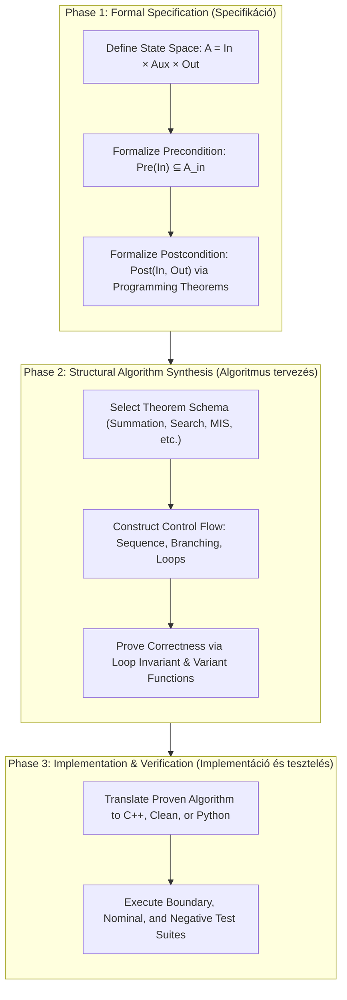
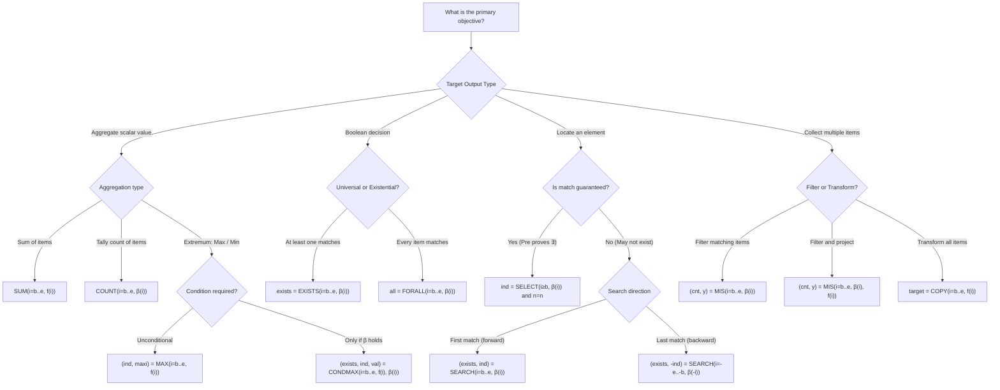

# Comprehensive Manual for the ELTE Specification Editor Web Application

**Course:** PROGRAMMING (*Programozás alapjai*) – `IP-18fPROGEG`  
**Institution:** Faculty of Informatics, Eötvös Loránd University (ELTE IK), Budapest  
**Application URL:** [https://progalap.elte.hu/specifikacio/](https://progalap.elte.hu/specifikacio/)  
**Version:** 1.5.1  
**Author / Maintainer:** Dr. Győző Horváth, S.D.G.  
**System Requirements & Authentication:** Requires an active ELTE network account (Caesar / INF account credentials).

---

## Table of Contents

1. [Overview & Pedagogical Architecture](#1-overview--pedagogical-architecture)
   - [1.1. The Three Formal Phases of Programming at ELTE](#11-the-three-formal-phases-of-programming-at-elte)
   - [1.2. The Role of the Specification Editor](#12-the-role-of-the-specification-editor)
   - [1.3. Bilingual Terminology Reference (English & Hungarian)](#13-bilingual-terminology-reference-english--hungarian)
2. [Specification Grammar & Block Structure](#2-specification-grammar--block-structure)
   - [2.1. Block Headers: English and Hungarian Forms](#21-block-headers-english-and-hungarian-forms)
   - [2.2. Identifiers and Lexical Conventions](#22-identifiers-and-lexical-conventions)
   - [2.3. C-Style Comments (Block and Line)](#23-c-style-comments-block-and-line)
   - [2.4. The "All Variables Mandate" (Variable Preservation Rule)](#24-the-all-variables-mandate-variable-preservation-rule)
   - [2.5. Hungarian Keyword Set (`Be:`/`Ki:`/`Ef:`/`Uf:`) & Canonical Answer Format](#25-hungarian-keyword-set-bekiefuf--canonical-answer-format)
3. [Type System & Data Structure Definitions](#3-type-system--data-structure-definitions)
   - [3.1. Elementary Mathematical Sets](#31-elementary-mathematical-sets)
   - [3.2. Discrete Intervals](#32-discrete-intervals)
   - [3.3. Indexed Sequences and 1D Arrays](#33-indexed-sequences-and-1d-arrays)
   - [3.4. Matrices (Two-Dimensional Arrays)](#34-matrices-two-dimensional-arrays)
   - [3.5. Records and Cartesian Direct Products](#35-records-and-cartesian-direct-products)
   - [3.6. Anonymous Tuples and Pattern Return Types](#36-anonymous-tuples-and-pattern-return-types)
   - [3.7. Type Aliasing and Custom Sets](#37-type-aliasing-and-custom-sets)
4. [Function Definitions (`Fn:`) & Problem Decomposition](#4-function-definitions-fn--problem-decomposition)
   - [4.1. Declaration and Mapping Syntax](#41-declaration-and-mapping-syntax)
   - [4.2. Decomposition and Scope](#42-decomposition-and-scope)
   - [4.3. Nested Algorithmic Patterns in Functions](#43-nested-algorithmic-patterns-in-functions)
5. [Preconditions (`Pre:`) & First-Order Quantifiers](#5-preconditions-pre--first-order-quantifiers)
   - [5.1. Relational and Logical Operators](#51-relational-and-logical-operators)
   - [5.2. Trivial and Default Preconditions](#52-trivial-and-default-preconditions)
   - [5.3. Range and Boundary Constraints](#53-range-and-boundary-constraints)
   - [5.4. Universal Quantifier (`∀`)](#54-universal-quantifier-)
   - [5.5. Existential Quantifier (`∃`)](#55-existential-quantifier-)
   - [5.6. Multi-Dimensional Nested Quantifiers](#56-multi-dimensional-nested-quantifiers)
6. [Postconditions (`Post:`) & Algorithmic Patterns (Programming Theorems)](#6-postconditions-post--algorithmic-patterns-programming-theorems)
   - [6.1. Master Programming Theorems Matrix & Decision Tree](#61-master-programming-theorems-matrix)
   - [6.2. Summation Pattern (`SUM`)](#62-summation-pattern-sum)
   - [6.3. Counting Pattern (`COUNT`, Hungarian `DARAB`)](#63-counting-pattern-count-hungarian-darab)
   - [6.4. Maximum and Minimum Selection (`MAX` / `MIN`)](#64-maximum-and-minimum-selection-max--min)
   - [6.5. Decision Patterns (`EXISTS` / `FORALL`)](#65-decision-patterns-exists--forall)
   - [6.6. Selection (`SELECT`) vs. Linear Search (`SEARCH`)](#66-selection-select-vs-linear-search-search)
   - [6.7. Reverse Linear Search (`SEARCH` from the Back)](#67-reverse-linear-search-search-from-the-back)
   - [6.8. Copy Pattern (`COPY`)](#68-copy-pattern-copy)
   - [6.9. Multiple Item Selection (`MIS`) – 2-Argument & 3-Argument Forms](#69-multiple-item-selection-mis--2-argument--3-argument-forms)
   - [6.10. Conditional Maximum Selection (`CONDMAX`) & Slot Skipping](#610-conditional-maximum-selection-condmax--slot-skipping)
   - [6.11. Conditional Post-Implications (`→`)](#611-conditional-post-implications-)
7. [Test Cases & Data Format (Data Pane)](#7-test-cases--data-format-data-pane)
   - [7.1. Interactive Workflow & Scaffold Shortcut](#71-interactive-workflow--scaffold-shortcut)
   - [7.2. Primitives, Arrays, and Matrix Notation](#72-primitives-arrays-and-matrix-notation)
   - [7.3. Record Formatting: YAML vs. Inline JSON](#73-record-formatting-yaml-vs-inline-json)
   - [7.4. Search Failure Output Semantics (`0` vs. `n+1`)](#74-search-failure-output-semantics-0-vs-n1)
   - [7.5. Test Suite Management and Status Badges](#75-test-suite-management-and-status-badges)
8. [Evaluation Engine, Execution Visualization & Sharing](#8-evaluation-engine-execution-visualization--sharing)
   - [8.1. Evaluation Mechanics & Runtime Interpretation](#81-evaluation-mechanics--runtime-interpretation)
   - [8.2. Stepper View & Yellow Token Highlight Semantics](#82-stepper-view--yellow-token-highlight-semantics)
   - [8.3. Step List View & Call Stack Transitions (`↓` / `↑`)](#83-step-list-view--call-stack-transitions---)
   - [8.4. Persistence, Permalinks, and Sharing](#84-persistence-permalinks-and-sharing)
   - [8.5. Official Baseline Test Case Specifications](#85-official-baseline-test-case-specifications)
9. [Comprehensive Case Studies & Verified Solutions](#9-comprehensive-case-studies--verified-solutions)
    - [Task 1: The Discworld Libraries (Search within Tuples)](#task-1-the-discworld-libraries-search-within-tuples)
    - [Task 2: Yossarian's Grid Map (Matrix Maximum & Tuple Properties)](#task-2-yossarians-grid-map-matrix-maximum--tuple-properties)
    - [Task 3: Trurl's Robot Factory (MIS with Nested Summation)](#task-3-trurls-robot-factory-mis-with-nested-summation)
    - [Task 4: Catbert's Coffee Breaks (Linear Search with Nested Universal Check)](#task-4-catberts-coffee-breaks-linear-search-with-nested-universal-check)
    - [Task 5: Dogbert's Star Brightness (Conditional Maximum & Slot Skipping)](#task-5-dogberts-star-brightness-conditional-maximum--slot-skipping)
    - [Bonus Case Study 1: Distinct Value Counting (Backward Quantifier Check)](#bonus-case-study-1-distinct-value-counting-backward-quantifier-check)
    - [Bonus Case Study 2: Record Projection with 3-Argument MIS & Multi-Line Comments](#bonus-case-study-2-record-projection-with-3-argument-mis--multi-line-comments)
    - [Bonus Case Study 3: Matrix Column Filter via Nested Universal Quantifier](#bonus-case-study-3-matrix-column-filter-via-nested-universal-quantifier)
    - [Task 6: Travel Agency Farthest City Price (Hungarian `Be:`/`Ki:`/`Ef:`/`Uf:` Style, User-Verified)](#task-6-travel-agency-farthest-city-price-hungarian-bekiefuf-style-user-verified)
    - [Task 7: Divisor Counting with `DARAB` (Hungarian `COUNT` Alias)](#task-7-divisor-counting-with-darab-hungarian-count-alias)
    - [Task 8: Divisor Sum with a Filtered `SUM`](#task-8-divisor-sum-with-a-filtered-sum)
    - [Task 9: Card Value via a Declared Lookup Table](#task-9-card-value-via-a-declared-lookup-table)
    - [Task 10: Christmas Trees (First Price Below `K`, `-1` Sentinel)](#task-10-christmas-trees-first-price-below-k--1-sentinel)
10. [Syntax Quick Reference & Troubleshooting Guide](#10-syntax-quick-reference--troubleshooting-guide)
    - [10.1. Complete Grammar Cheat Sheet](#101-complete-grammar-cheat-sheet)
    - [10.2. Top 17 Common Pitfalls & Diagnostic Fixes](#102-top-17-common-pitfalls--diagnostic-fixes)

---

## 1. Overview & Pedagogical Architecture

The **ELTE Specification Editor** (*Specifikáció szerkesztő*) is a specialized web-based computer science education environment created at the Faculty of Informatics, Eötvös Loránd University (*ELTE IK*), Budapest. It serves as the primary formal modeling platform for the foundation course **PROGRAMMING** (`IP-18fPROGEG`).

### 1.1. The Three Formal Phases of Programming at ELTE
In the software engineering methodology established at ELTE (based on the relational programming model developed by Dr. Tibor Gregorics, Dr. László Zsakó, and Dr. Győző Horváth), software development is partitioned into three formal stages:



### 1.2. The Role of the Specification Editor
The ELTE Specification Editor operationalizes **Phase 1**. Unlike static markdown or LaTeX editors, this environment embeds an **active symbolic execution and evaluation engine**.

When a student writes a mathematical specification and supplies test data:
1. The tool parses the input types, functions, preconditions, and postconditions into a syntax tree.
2. It validates the input constraints ($Pre$).
3. It **symbolically evaluates the mathematical postconditions ($Post$) directly against the test data**.
4. It compares the computed state with the user's expected outputs and visually indicates whether the specification accurately solves the task.

### 1.3. Bilingual Terminology Reference (English & Hungarian)

| English Term | Authentic Hungarian Term | Mathematical / Tool Notation |
|:---|:---|:---|
| **State Space** | Állapottér | $A = A_1 \times A_2 \times \dots \times A_n$ |
| **Problem** | Feladat | $F \subseteq A$ |
| **Precondition** | Előfeltétel ($EF$) | `Pre: ` |
| **Postcondition** | Utófeltétel ($UF$) | `Post: ` |
| **Input Variables** | Bemeneti változók | `In: ` |
| **Auxiliary Variables** | Segédváltozók | `Aux: ` / `Sa: ` |
| **Output Variables** | Kimeneti változók | `Out: ` |
| **Function Definition** | Függvénydefiníció | `Fn: ` |
| **Programming Theorems** | Programozási tételek | Algorithmic pattern macros |
| **Summation** | Összegzés | `SUM(i=b..e, f(i))` |
| **Counting** | Megszámolás / Számlálás | `COUNT(i=b..e, β(i))` |
| **Maximum Selection** | Maximumkiválasztás | `MAX(i=b..e, f(i))` |
| **Minimum Selection** | Minimumkiválasztás | `MIN(i=b..e, f(i))` |
| **Decision (Existential)** | Eldöntés | `EXISTS(i=b..e, β(i))` |
| **Universal Decision** | Univerzális eldöntés | `FORALL(i=b..e, β(i))` |
| **Selection** | Kiválasztás | `SELECT(i≥b, β(i))` |
| **Linear Search** | Lineáris keresés | `SEARCH(i=b..e, β(i))` |
| **Copy / Mapping** | Másolás | `COPY(i=b..e, f(i))` |
| **Multiple Item Selection** | Kiválogatás | `MIS(i=b..e, β(i))` |
| **MIS with Transformation** | Kiválogatás másolással | `MIS(i=b..e, β(i), f(i))` |
| **Conditional Maximum** | Feltételes maximumkeresés | `CONDMAX(i=b..e, f(i), β(i))` |
| **Compound Theorem** | Tétel-összetétel | Nested pattern inside `Fn: ` or `Post: ` |

> **Note: Hungarian block keywords are accepted too.** The editor accepts the authentic Hungarian header spellings — `Be:` (*Bemenet* = In), `Sa:` (auxiliary; *Aux*), `Ki:` (*Kimenet* = Out), `Fv:` (*Függvény* = Fn), `Ef:` (*Előfeltétel* = Pre), `Uf:` (*Utófeltétel* = Post) — all six verified against the live tool. See [2.5](#25-hungarian-keyword-set-bekiefuf--canonical-answer-format) for the canonical answer layout and [Task 6](#task-6-travel-agency-farthest-city-price-hungarian-bekiefuf-style-user-verified) for a complete verified example. Do **not** invent spellings from the English meaning: `Segéd:` is rejected, the real aux keyword is `Sa:` — see the tip in [2.1](#21-block-headers-english-and-hungarian-forms).

---

## 2. Specification Grammar & Block Structure

A complete formal specification consists of up to six distinct blocks. Each block captures a mathematically rigorous facet of the problem contract:

| Block Name | Prefix Keyword | Compulsory? | Formal Role in Program Verification |
|:---|:---:|:---:|:---|
| **Input** | `In: ` | **Yes** | Declares input state variables and their underlying mathematical domain sets. |
| **Auxiliary** | `Aux: ` | No | Declares internal helper variables required by postcondition patterns (e.g. index trackers). |
| **Output** | `Out: ` | **Yes** | Declares target output state variables computed by the program and their codomains. |
| **Function** | `Fn: ` | No | Declares sub-functions and encapsulates nested algorithmic patterns for problem decomposition. |
| **Precondition** | `Pre: ` | **Yes** | Logical predicate constraining inputs. Must evaluate to `true` prior to program execution. |
| **Postcondition** | `Post: ` | **Yes** | Logical predicate binding inputs, outputs, and programming theorems. Specifies final state. |

### 2.1. Block Headers: English and Hungarian Forms

> **Important: Use the exact keyword spelling.** Headers are case-sensitive: `In:`, `Aux:`, `Out:`, `Fn:`, `Pre:`, `Post:` (English) and `Be:`, `Ki:`, `Ef:`, `Uf:` (Hungarian). Unknown spellings such as `in:`, `IN:`, or `Pre :` trigger a fatal parse error.
>
> When the payload goes on the **same line** as the colon, a space is mandatory (`Pre: -`). When the header stands **alone on its line**, the payload starts on the next line and no trailing space is used (Layout B below).

#### Keyword pairs

| Block | English | Hungarian | Compulsory |
|:---|:---|:---|:---:|
| Input | `In: ` | `Be:` | Yes |
| Auxiliary | `Aux: ` | `Sa:` | No |
| Output | `Out: ` | `Ki:` | Yes |
| Function | `Fn: ` | `Fv:` | No |
| Precondition | `Pre: ` | `Ef:` | Yes |
| Postcondition | `Post: ` | `Uf:` | Yes |

> **Tip: Never guess a keyword spelling — make the parser tell you.** Provoke the error on purpose: put a bogus block keyword after a declaration list and the message enumerates everything accepted *at that position*. Fed `Segéd:`, the editor answered:
>
> `Line 8, column 1: Expected ",", "Aux:", "Ki:", "Out:", "Sa:", new line, or white space but "S" found.`
>
> Two facts fall out of that single message. First, the Hungarian auxiliary block is **`Sa:`**, not `Segéd:` — the plausible-looking translation is wrong. Second, the expected set is position-sensitive: after the declaration cluster you may continue with a comma or with another *declaration* block (`Aux:`, `Ki:`, `Out:`, `Sa:` — English and Hungarian mixed freely), while `Fn:`/`Pre:`/`Post:` are not legal there. That is the formal confirmation of the block order in [2.5](#25-hungarian-keyword-set-bekiefuf--canonical-answer-format): declarations first, conditions last.

#### Two accepted payload layouts

**Layout A — payload on the same line** (the form used by every other example in this manual):

```text
In: n∈N, nums∈Z[1..n]
```

**Layout B — header alone on its line, one declaration per line** (the verified Hungarian style, see [2.5](#25-hungarian-keyword-set-bekiefuf--canonical-answer-format)):

```text
Be:
n∈N,
ar∈N[1..n],
tav∈N[1..n]
```

In Layout B each declaration except the last ends with a comma, exactly as it would on a single line; the newline simply replaces the space. Blank lines between blocks — and even between declarations *inside* a block — are cosmetic and safe. Header spelling stays case-sensitive in both layouts.

Both layouts are verified for the Hungarian keywords too: `Be: szam∈N` (Layout A) and the bare-`Be:` multi-line form above (Layout B) both parse, as does a `Be:` block containing blank lines between declarations (see [Task 9](#task-9-card-value-via-a-declared-lookup-table)). Layout B is now confirmed for **all six** Hungarian headers — `Be:`, `Sa:`, `Ki:`, `Fv:`, `Ef:`, `Uf:` — each followed by a newline rather than a space.

Layout B applied to every block at once:

```text
Be:
n∈N,
k∈N

Sa:
van∈L,
ind∈N

Ki:
sorszam∈Z

Fv:
kisebb:N->L,
kisebb(i)=ar[i]<k

Ef:
n>=1

Uf:
(van,ind)=SEARCH(i=1..n, kisebb(i)) and sorszam=ind
```

### 2.2. Identifiers and Lexical Conventions
1. **Variable Identifiers:** Must begin with a lowercase Latin letter (`a`–`z`), followed by alphanumeric characters. No whitespace or punctuation is allowed.  
   - *Valid:* `nums`, `visitedCount`, `coffe`, `x1`, `r1`  
   - *Invalid:* `Nums`, `visited count`, `1x`, `max-val`
2. **Set and Type Identifiers:** Must begin with an uppercase Latin letter (`A`–`Z`).  
   - *Valid:* `N`, `Z`, `Student`, `Grade`, `Walk`  
   - *Invalid:* `student`, `n`, `z`
3. **List Delimiters:** Multiple variable declarations within `In:`, `Aux:`, `Out:`, and parameter lists are separated by commas (`,`).
4. **Reserved words cannot be identifiers.** The lowercase keywords that appear inside formulas are tokenized as keywords, so they must never be used as a declaration name: `and`, `or`, `not`, `mod`, `element`, `exists`, `forall` (and presumably their Hungarian counterparts `és`, `vagy`, `nem`). Names such as `sum`, `max` or `min` *are* legal, because every theorem macro is uppercase (`SUM`, `MAX`, `MIN`) — the case difference keeps them apart.
   - *Invalid:* `Aux: exists∈L` — reported by the live editor as `incomplite type for exists: undefined is not boolean`. Use `van`, `talalt`, `letezik2`, … instead. See pitfall #16 in [10.2](#102-top-17-common-pitfalls--diagnostic-fixes).
   - *Valid:* `sum∈N`, `max∈N`, `van∈L`, `talalt∈L`.

### 2.3. C-Style Comments (Block and Line)
Two comment forms are accepted by the parser:

- `/* ... */` — block comment, may span several lines.
- `// ...` — line comment, runs to the end of the line and may be appended after real content (verified, see [Task 7](#task-7-divisor-counting-with-darab-hungarian-count-alias)).

The block form is commonly used in course submissions to document theorem variable bindings:

```text
In: Trun=(time:N x loc:S), n∈N, runs∈Trun[1..n]
Out: cnt∈N, location∈S[1..cnt]
Pre: -
Post: (cnt,location)=MIS(i=1..n,runs[i].time>30,runs[i].loc)
/* (cnt,y)=MIS(i=b..e,A(i),f(i))
   cnt, y ~ cnt, location
   b..e ~ 1..n
   A(i) ~ runs[i].time>30
   f(i) ~ runs[i].loc
*/
```

The line form is handy for annotating a formula with the plain-language reading of an operator:

```text
Be: szam∈N

Ki: osztok∈N

Ef: szam>=1

Uf: osztok=DARAB(i=1..szam, i|szam)    // szam mod i = 0
```

### 2.4. The "All Variables Mandate" (Variable Preservation Rule)

> **Warning: The All Variables Mandate — verified against the editor.** Every input variable declared in `Be:` / `In: ` must occur somewhere in the `Uf:` / `Post:`. A specification with one unused input is rejected with a message that names it and points at its declaration line:
>
> `Line 5, column 1: egyeb is missing from the post condition!`
>
> Three details worth knowing:
> - The reported position is the variable's **declaration line**, not the postcondition — a red mark inside the `Be:` block means "this input is never consumed".
> - Appearing in the **`Ef:` does not count**. A variable used only in the precondition is still reported as missing.
> - The check runs *after* the whole document has parsed, so seeing this message also proves that the syntax of every other block was accepted. It is the last check to fire, which makes it a useful milestone.

To satisfy this mandate when a pattern does not explicitly reference an input variable, conjoin a trivial identity equality constraint using `and`:

```text
In: n∈N, nums∈Z[1..n]
Out: ind∈N
Pre: ∃i∈[1..n]:(nums[i] mod 2 = 1)
Post: ind=SELECT(i≥1, nums[i] mod 2 = 1) and n=n
```
*Because `SELECT(i≥1, ...)` specifies no upper bound $n$, adding `and n=n` binds $n$ into the postcondition, ensuring compliance with the semantic validator. Verified: an identity conjunct such as `egyeb=egyeb` really does satisfy the check — a specification rejected for a missing input goes green as soon as the filler is appended.*

If multiple input variables are unused, chain them: `and n=n and k=k`.

### 2.5. Hungarian Keyword Set (`Be:`/`Ki:`/`Ef:`/`Uf:`) & Canonical Answer Format

The tool accepts a fully Hungarian header set, verified on the live editor:

| Hungarian | English | Meaning |
|:---|:---|:---|
| `Be:` | `In: ` | *Bemenet* — input variables |
| `Ki:` | `Out: ` | *Kimenet* — output variables |
| `Ef:` | `Pre: ` | *Előfeltétel* — precondition |
| `Uf:` | `Post: ` | *Utófeltétel* — postcondition |
| `Sa:` | `Aux: ` | auxiliary / helper variables (*Segéd*-…) |
| `Fv:` | `Fn: ` | *Függvény* — functions |

#### Canonical answer layout

**Default answer format:** when asked to write or fix a specification, emit it in this layout — Hungarian headers **and Hungarian identifiers**, one declaration per line, commas between them, a blank line between blocks, and `Ki:` placed *before* the conditions:

```text
Be:
n∈N,
ar∈N[1..n],
tav∈N[1..n]

Ki:
max∈N

Ef:
1<=n and n<=100 and ∀i∈[1..n]:(1<=ar[i] and ar[i]<=2000000 and 1<=tav[i] and tav[i]<=20000)

Uf:
∃i∈[1..n]:(∀j∈[1..n]:(tav[j]<tav[i] vagy (tav[j]=tav[i] és ar[j]>=ar[i])) és ar[i]=max)
```

Rules that keep this layout parseable:

1. **Block order:** declarations first (`Be:` → `Sa:` → `Ki:` → `Fv:`), conditions last (`Ef:` → `Uf:`). `Ki:` declares the result variable — it is *not* the last block. The editor enforces this: after a declaration list it accepts only `,` or another declaration keyword (`Aux:`, `Ki:`, `Out:`, `Sa:`), never `Fn:`/`Pre:`/`Post:` (see the tip in [2.1](#21-block-headers-english-and-hungarian-forms)).
2. **One declaration per line**, each ending in a comma except the last one of the block.
3. **Blank line between blocks**; blank lines inside a block are harmless.
4. **Hungarian connectives are accepted:** `és` = `and`, `vagy` = `or` (`nem` = `not` is unverified). Mixing languages inside one formula (`a vagy b and c`) parses but is bad style — stay consistent within the file.
5. **ASCII comparisons are accepted:** `<=`, `>=`, `!=`, `=`, `<`, `>`. The Unicode `≤`, `≥`, `≠` work as well.
6. **`Uf:` may be a pure first-order formula** — `∃`/`∀` plus `->` implication and *no* theorem macro (see [6.12](#612-relational-first-order-postconditions-no-macro-style)). This is the style used in the lecture notes; the macro style of section 6 is the tool-idiomatic alternative.
7. **Lowercase variables never collide with uppercase macros:** an output variable named `max` is fine next to `MAX(...)`, because pattern keywords are uppercase. (Reserved *lowercase* words such as `exists` are a different story — see [2.2](#22-identifiers-and-lexical-conventions).)
8. **English block names remain valid.** Use Layout A of [2.1](#21-block-headers-english-and-hungarian-forms) when the user or the existing file is written in English — and never silently translate a working Hungarian file into English, or vice versa.
9. **Write everything in Hungarian by default.** Unless the user asks for English or is working on an English file, name the variables in Hungarian too — `szam`, `ar`, `tav`, `osztok`, `sorszam`, `ertek`, `van`, `talalat` — and keep comments Hungarian. The block keywords and the identifiers should not be mixed: a Hungarian `Be:`/`Ki:`/`Ef:`/`Uf:` header over English `n, nums, cnt` reads as a half-translated answer. This manual's own `In: n∈N, nums∈Z[1..n]` examples are *syntax illustrations*, not the house style — do not carry their English names into an answer.

#### Parallel arrays vs. records

A task whose input is `N`, then `N` lines of `distance price` can be modelled either way:

- **Parallel arrays (Hungarian style, user-verified):** `tav∈N[1..n]`, `ar∈N[1..n]` — mirrors the line-per-city input directly.
- **Record array:** `varos∈Varos[1..n], Varos=(tav:N x ar:N)` — needed when a pattern must project a record field, e.g. `MIS(i=1..n, varos[i].tav>k, varos[i].ar)`.

Both are correct. Pick whichever keeps the `Uf:` shortest, then keep the test data consistent with that choice.

---

## 3. Type System & Data Structure Definitions

The specification tool features a rich mathematical type system spanning primitive numbers, discrete intervals, indexed sequences, matrices, Cartesian direct products (records), and custom type aliases.

### 3.1. Elementary Mathematical Sets

| Mathematical Symbol | Editor ASCII | Meaning | Example Declaration | Notes |
|:---:|:---:|:---|:---|:---|
| $\mathbb{N}$ | `N` | Natural numbers $\{0, 1, 2, 3, \dots\}$ | `a∈N` or `a element N` | Non-negative integers. The keyword `element` can substitute for `∈`. |
| $\mathbb{Z}$ | `Z` | Signed integers $\{\dots, -2, -1, 0, 1, 2, \dots\}$ | `b∈Z` | Positive, zero, or negative discrete numbers. |
| $\mathbb{R}$ | `R` | Real numbers (floating point) | `c∈R` | Continuous numeric quantities. |
| $\mathbb{L}$ | `L` | Logical / Boolean truth values | `d∈L` | Values: `true`, `false`. Verified as a declarable type (`van∈L` in a `Sa:` block, evaluated green) — but do not name the variable `exists`, see [2.2](#22-identifiers-and-lexical-conventions). |
| $\mathbb{S}$ | `S` | Strings / Text literals | `e∈S` | Text values, e.g. `"L1"`, `"restaurant"`. |
| $\mathbb{C}$ | `C` or `K` | Characters | `f∈C` or `f2∈K` | Individual characters (`K` is the Hungarian alias for *Karakter*). |

### 3.2. Discrete Intervals
An interval models a contiguous, closed set of integers between two boundary values:
```text
iv1∈[1..3]
```
- `iv1` may take any value from $\{1, 2, 3\}$.
- Dynamic bounds are supported: `iv2∈[2+3..n*2]`.

### 3.3. Indexed Sequences and 1D Arrays
Sequences represent homogeneous ordered collections with explicit or implicit indexing:

| Sequence Syntax | Index Range & Semantics | Introspection & Element Access |
|:---|:---|:---|
| `x1∈N[1..3]` | 3 natural numbers indexed from 1 to 3. | `x1[1]`, `x1[2]`, `x1[3]`. |
| `x2∈N[-1..1]` | 3 natural numbers with offset indexing: $\{-1, 0, 1\}$. | `x2[-1]`, `x2[0]`, `x2[1]`. |
| `n∈N, x∈Z[1..n]` | Dynamic array of length $n$; dimension $n$ provided in `In: `. | Standard ELTE course convention. |
| `x3∈N[1..]` | Variable-length array starting at index 1; length inferred from data. | Length queried via `length(x3)`. |
| `x4∈N[0..]` | Zero-indexed variable-length array $\{0, 1, \dots, \text{length}-1\}$. | Length queried via `length(x4)`. |
| `x5∈N[]` | Shorthand sequence notation. | Equivalent to `x5∈N[1..]`. |
| `x6∈N[]=[5,1,2]` | Constant array pre-populated with literal elements. | Immutable sequence. |
| `x7∈N[2+3..n*2]` | Array whose lower and upper bounds are dynamic arithmetic expressions. | Bound expressions evaluated at runtime. |
| `lapok∈S[1..8]=["also","felso","kiraly","VII","VIII","IX","X","asz"]` | Fixed-size array **with a literal initializer**, used as an input to model a lookup table. | `lapok[i]`. Verified in an `In:`/`Be:` declaration — see [Task 9](#task-9-card-value-via-a-declared-lookup-table). |

#### Introspection Functions for Sequences:
- `length(arr)`: Returns the total count of elements in array `arr`.
- `from(arr)`: Returns the lower index boundary of array `arr`.
- `to(arr)`: Returns the upper index boundary of array `arr`.

### 3.4. Matrices (Two-Dimensional Arrays)
Matrices model rectangular two-dimensional grids of homogeneous elements:

| Matrix Syntax | Dimension Semantics | Element Access |
|:---|:---|:---|
| `m1∈Z[1..8,1..8]` | Fixed $8 \times 8$ grid (e.g. chessboard). | `m1[row, col]` (e.g. `m1[3, 6]`). |
| `m2∈Z[1..n,1..m]` | Dynamic $n \times m$ matrix ($n$ rows, $m$ columns). | `m2[i, j]` where $i \in [1..n], j \in [1..m]$. |
| `m3∈Z[0..,0..]` | Zero-indexed matrix whose dimensions are inferred from test data. | Top-left cell is `m3[0, 0]`. |
| `m4∈Z[,]` | Shorthand matrix notation. | Equivalent to `m4∈Z[1..,1..]`. |
| `m5∈Z[-1..1,-1..1] = [[2,1,2],[1,0,1],[2,1,1]]` | Matrix initialized with nested 2D literal rows. | Literal row vectors. |

> **Caution: Matrix vs. Array-of-Arrays Distinction**:  
> `m∈Z[1..n,1..m]` is a **2D Matrix** accessed via comma indexing: `m[i, j]`.  
> `m∈Z[1..n][1..m]` is a **Sequence of Sequences** (Jagged Array) accessed via chained indexing: `m[i][j]`.  
> These types are fundamentally incompatible in the specification engine!

### 3.5. Records and Cartesian Direct Products
Records combine heterogeneous fields into unified composite structures using Cartesian direct products (`x`):

```text
R1∈(name:S x note:N)
```
- Defines an ordered pair where `name` is a String and `note` is a Natural number.
- Field access uses dot notation: `r1.name`, `r1.note`.

Direct product sets over discrete intervals:
```text
R4∈(m1:[1..2] x m2:[3..4])
```
*`R4` represents the Cartesian direct product $\{(1,3), (1,4), (2,3), (2,4)\}$. Any concrete instance is one pair from this set.*

### 3.6. Anonymous Tuples and Pattern Return Types
Tuples group multiple values without requiring an explicit named record definition:
```text
(3, 5) = (3, 5)
(3, 5).1 = 3 and (3, 5).2 = 5
```
- Tuple elements are accessed by 1-based numeric indices: `.1`, `.2`.
- When an algorithmic pattern returns a tuple, field accessors `.maxval` and `.maxind` can be invoked directly on the returned result (see [Task 2](#task-2-yossarians-grid-map-matrix-maximum--tuple-properties)).

#### Pattern Unpacking and Slot Skipping Syntax:
- **Trailing comma (discard value):** `(mpx,) = MAX(...)` (captures index only).
- **Leading comma (discard index):** `(,maxval) = MAX(...)` (captures value only).
- **Slot skipping (discard middle index):** `(exists,,maxval) = CONDMAX(...)` (captures existence and value, ignoring index).

### 3.7. Type Aliasing and Custom Sets
Custom type names provide clarity for complex domain models. Type aliases must begin with an **uppercase letter** and use `=` (never `:=`):

```text
Grade = [1..5], j∈Grade
```

Chained type aliasing:
```text
Grade = FromOneToFive, FromOneToFive = [1..5], j2∈Grade
```

Structured record definitions:
```text
Student = (name:S x grade:N)
students ∈ Student[1..]
```

Arrays of records and jagged arrays:
```text
Grade = [1..5]
Student2 = (name:S x grades:Grade[])
StudentArray = Student2[]
classRoster ∈ StudentArray

/* Jagged array: array of arrays of variable length */
Row = N[]
zigzag ∈ Row[]
```

---

## 4. Function Definitions (`Fn:`) & Problem Decomposition

When an algorithm requires compound or nested logic (e.g. finding the maximum of row maximums, or filtering items by a range sum), the specification decomposes the problem by specifying the nested pattern as a custom sub-function under the `Fn: ` block.

### 4.1. Declaration and Mapping Syntax
A function definition consists of two clauses separated by a comma:
1. **Signature:** `name: Domain -> Codomain` (use the ASCII arrow `->`; the Unicode `→` was reported failing here — see pitfall #9 in [10.2](#102-top-17-common-pitfalls--diagnostic-fixes)).
2. **Body:** `name(parameter_list) = expression`.

```text
Fn: f:N→N, f(p)=p*2
Fn: square:Z→N, square(n)=n*n
Fn: add:Z x Z→Z, add(a,b)=a+b
Fn: swap:Z x Z→Z x Z, swap(a,b)=(b,a)
Fn: grade:Student→N, grade(h)=h.grade
Fn: index:N[] x N→N, index(x,i)=x[i]
```

### 4.2. Decomposition and Scope
Functions have full access to all input variables declared in `In: `, unless a function parameter shadows the name:
```text
In: n∈N, nums∈Z[1..n]
Fn: f2:Z→Z, f2(p)=p+n
```

### 4.3. Nested Algorithmic Patterns in Functions
The primary power of `Fn: ` lies in encapsulating nested algorithmic patterns:

#### Matrix Row Maximum (`MAX` inside `Fn:`):
```text
Fn: maxcol:N→N x N, maxcol(i)=MAX(j=1..m, map[i,j])
```
*Finds the maximum element within row `i` across all columns `j=1..m`. Returns a tuple `(col_index, max_value)`.*

#### Sliding Window Summation (`SUM` inside `Fn:`):
```text
Fn: total:N→N, total(i)=SUM(j=i-d..i-1, tr[j])
```
*Computes the sum of elements over the preceding `d` elements relative to index `i`.*

#### Row-Wise Universal Property (`FORALL` inside `Fn:`):
```text
Fn: morethan5:N→L, morethan5(i)=FORALL(j=1..4, coffe[i,j]>5)
```
*Evaluates whether every coffee break on day `i` exceeded 5 liters.*

#### Row-Wise Existential Property (`EXISTS` inside `Fn:`):
```text
Fn: lessthan5:N→L, lessthan5(i)=EXISTS(j=1..4, coffe[i,j]<5)
```
*Evaluates whether at least one coffee break on day `i` fell below 5 liters.*

#### Frequency Counting (`COUNT` inside `Fn:`):
```text
Fn: numOfvisits:N→N, numOfvisits(i)=COUNT(j=1..n, visited[j]=i)
```
*Tallies how many times location `i` occurs within the `visited` sequence.*

#### Distinct Value Filter (Backward `FORALL` inside `Fn:`):
```text
Fn: nV:N→L, nV(i)=FORALL(j=1..i-1, races[i].time≠races[j].time)
```
*Returns `true` if and only if `races[i].time` has never appeared earlier in the sequence, ensuring distinct value filtering.*

#### Column-Wise Universal Property (`FORALL` inside `Fn:`):
```text
Fn: lt:N→L, lt(j)=FORALL(i=1..n, lates[i,j]>k)
```
*Evaluates whether every student in session `j` arrived late by more than $k$ minutes.*

---

## 5. Preconditions (`Pre:`) & First-Order Quantifiers

The precondition specifies constraints that the input data must satisfy for the specification to be valid.

### 5.1. Relational and Logical Operators

| Operator | ASCII Alternative | Mathematical Meaning | Example |
|:---:|:---:|:---|:---|
| `=` | | Equality | `n = 5` |
| `≠` | `!=` | Inequality | `x ≠ y` |
| `<` | | Strictly less than | `d < n` |
| `>` | | Strictly greater than | `n > 0` |
| `≤` | `<=` | Less than or equal to | `2 ≤ c` |
| `≥` | `>=` | Greater than or equal to | `c ≥ 20` |
| `mod` | `%` | Modulo (remainder) | `nums[i] mod 2 = 1`, `i%2=1` |
| `\|` | — | Divisibility: `a\|b` means *a divides b*, i.e. `b mod a = 0` | `i\|szam`, `i\|n` |
| `and` | Hungarian `és` | Logical Conjunction (AND) | `n > 0 and d < n`, `1<=n és n<=100` |
| `or` | Hungarian `vagy` | Logical Disjunction (OR) | `a < 0 or a > 10`, `tav[j]<tav[i] vagy tav[j]=tav[i]` |
| `not` | Hungarian `nem` *(unverified)* | Logical Negation (NOT) | `not false` |
| `→` | `->` | Logical Implication | `van -> sorszam=ind` (ASCII form verified in a `Uf:`; the glyph is unreliable in an `Fv:` signature — pitfall #9) |

> **Tip: Hungarian connectives are accepted** (`és`, `vagy` verified; `nem` unverified). Comparisons accept both the glyph and the ASCII form (`≤`/`<=`, `≥`/`>=`, `≠`/`!=`), so a Hungarian `Ef:`/`Uf:` can be typed entirely on a US keyboard: `1<=n és n<=100`. See [2.5](#25-hungarian-keyword-set-bekiefuf--canonical-answer-format).
>
> **`mod` and `%` are interchangeable**, and `a|b` is the divisibility relation — *a divides b*. Course solutions lean on both: `osztok=DARAB(i=1..szam, i|szam)` counts the divisors of `szam`, and `sum=SUM(i=1..n,i, i|n)` adds them up. See [6.2](#62-summation-pattern-sum) and [Task 7](#task-7-divisor-counting-with-darab-hungarian-count-alias).

### 5.2. Trivial and Default Preconditions
If a task imposes no preconditions on the input data, use any of the following equivalent notations:
- `Pre: -` (Dash – standard course convention)
- `Pre: true`
- `Pre: not false`
- `Pre: 3=3`

### 5.3. Range and Boundary Constraints
To restrict a scalar variable `a` to the range $[2, 7]$, the following notations are valid:
```text
Pre: a∈[2..7]
Pre: 2≤a≤7
Pre: a≥2 and a≤7
```

### 5.4. Universal Quantifier (`∀`)
Used to assert that a condition holds for **all** elements in an index range:
```text
∀variable∈[start..end]:(predicate)
```

Examples:
- All elements positive: `∀i∈[1..3]:(i>0)`
- Array elements exceed 10: `∀i∈[1..n]:(x[i]>10)`
- Non-negative struct coordinates: `∀i∈[1..n]:(pl[i].x≥0 and pl[i].y≥0)`

### 5.5. Existential Quantifier (`∃`)
Used to assert that **at least one** element in an index range satisfies a condition:
```text
∃variable∈[start..end]:(predicate)
```

Examples:
- Array contains an odd number: `∃i∈[1..n]:(nums[i] mod 2 = 1)`
- Open array element below 3: `∃i∈[1..length(x3)]:(x3[i]<3)`
- Dynamic query bounds: `∃i∈[from(x3)..to(x3)]:(x3[i]<3)`

### 5.6. Multi-Dimensional Nested Quantifiers
Quantifiers can be nested to traverse two-dimensional structures:
- Every row contains at least one cell with value 10:
  ```text
  ∀i∈[1..8]:(∃j∈[1..8]:(m1[i,j]=10))
  ```
- All matrix cells are non-negative:
  ```text
  ∀i∈[1..n]:(∀j∈[1..m]:(map[i,j]≥0))
  ```

---

## 6. Postconditions (`Post:`) & Algorithmic Patterns (Programming Theorems)

The postcondition establishes the logical relationship between input and output data. In the ELTE specification system, standard programming theorems are expressed through concise pattern macros.

### 6.1. Master Programming Theorems Matrix

| Programming Theorem | Hungarian Name | Macro Syntax | Return Value / Tuple Structure | Primary Usage |
|:---|:---|:---|:---:|:---|
| **Summation** | *Összegzés* | `sum=SUM(i=b..e, f(i))` — filtered: `sum=SUM(i=b..e, f(i), β(i))` | Scalar number | Accumulate values over a sequence. |
| **Counting** | *Megszámolás* | `cnt=COUNT(i=b..e, β(i))` — Hungarian alias `DARAB` | Scalar integer | Tally occurrences satisfying condition $\beta$. |
| **Maximum Selection** | *Maximumkiválasztás* | `(ind,maxi)=MAX(i=b..e, f(i))` | `(index, value)` | Locate first maximal element. |
| **Minimum Selection** | *Minimumkiválasztás* | `(ind,mini)=MIN(i=b..e, f(i))` | `(index, value)` | Locate first minimal element. |
| **Decision (Exists)** | *Eldöntés* | `exists=EXISTS(i=b..e, β(i))` | Boolean (`L`) | Test whether at least one element matches $\beta$. |
| **Decision All** | *Univerzális eldöntés* | `all=FORALL(i=b..e, β(i))` | Boolean (`L`) | Test whether every element matches $\beta$. |
| **Selection** | *Kiválasztás* | `ind=SELECT(i≥b, β(i))` | Scalar index | Locate matching element (assumes item exists!). |
| **Linear Search** | *Keresés* | `(exists,ind)=SEARCH(i=b..e, β(i))` | `(Boolean, index)` | Search with existence flag. |
| **Reverse Linear Search** | *Keresés hátulról* | `(exists,-ind)=SEARCH(i=-e..-b, β(-i))` | `(Boolean, index)` | Search backward from sequence tail. |
| **Copy** | *Másolás* | `target=COPY(i=b..e, f(i))` | Sequence array | Transform each element by function $f$. |
| **Multiple Item Selection (2-arg)** | *Kiválogatás* | `(cnt,y)=MIS(i=b..e, β(i))` | `(count, index_array)` | Collect all indices matching $\beta$. |
| **Multiple Item Selection (3-arg)** | *Kiválogatás másolással* | `(cnt,y)=MIS(i=b..e, β(i), f(i))` | `(count, value_array)` | Collect transformed elements matching $\beta$. |
| **Conditional Maximum** | *Feltételes maximum* | `(exists,maxind,mval)=CONDMAX(i=b..e, f(i), β(i))` | `(Boolean, index, value)` | Locate maximal element among items matching $\beta$. |

> **Note: Pattern macros have Hungarian spellings too.** `DARAB` = `COUNT` is verified in course solutions: `osztok=DARAB(i=1..szam, i|szam)` (see [Task 7](#task-7-divisor-counting-with-darab-hungarian-count-alias)). `SUM` also accepts an **optional third argument** — a filter condition — so `SUM(i=1..n, i, i|n)` sums only the terms for which `i|n` holds (see [6.2](#62-summation-pattern-sum) and [Task 8](#task-8-divisor-sum-with-a-filtered-sum)). Aliases for `MAX`, `SEARCH`, `MIS`, `CONDMAX`, … are presumed to exist but are **not verified** — never invent one; use the English macro unless the user's own file shows the alias.

#### Decision Tree for Programming Theorems (Tétel-kiválasztási döntési fa)



---

### 6.2. Summation Pattern (`SUM`)
Calculates the arithmetic total of an expression $f(i)$ over an index range:
```text
In: n∈N, numbers∈N[1..n]
Out: sum∈N
Pre: -
Post: sum=SUM(i=1..n, numbers[i])
```

**Optional filter (third argument).** `SUM(i=b..e, f(i), β(i))` adds only the terms for which `β(i)` holds — the summation analogue of the 3-argument `MIS`:

```text
Be: n∈N

Ki: sum∈N

Ef: n>=1

Uf: sum=SUM(i=1..n,i, i|n)      // the divisors of n
```

This is the standard idiom for "sum of the divisors", "sum of the elements satisfying a condition", and similar tasks. Whitespace around the operator is free (`sum = SUM(...)` parses the same as `sum=SUM(...)`).

### 6.3. Counting Pattern (`COUNT`, Hungarian `DARAB`)
Counts how many indices in the range satisfy a boolean condition:
```text
In: n∈N, numbers∈N[1..n]
Out: cnt∈N
Pre: -
Post: cnt=COUNT(i=1..n, numbers[i] mod 2 = 1)
```

**Hungarian alias `DARAB`.** `COUNT` and `DARAB` are interchangeable; course solutions frequently write the Hungarian name:

```text
Be: szam∈N

Ki: osztok∈N

Ef: szam>=1

Uf: osztok=DARAB(i=1..szam, i|szam)    // szam mod i = 0
```

The counting macro takes exactly the two arguments shown: a loop range and a boolean condition. See [Task 7](#task-7-divisor-counting-with-darab-hungarian-count-alias) for the full write-up.

### 6.4. Maximum and Minimum Selection (`MAX` / `MIN`)
Locates the index and extreme value:
```text
(ind, maxi)=MAX(i=1..n, numbers[i])
(ind, mini)=MIN(i=1..n, numbers[i])
```
- If multiple elements share the maximum value, `MAX` selects the **first** occurrence.
- If only the index is needed: `(mpx,) = MAX(...)` (trailing comma).
- If only the value is needed: `(,maxval) = MAX(...)`.

### 6.5. Decision Patterns (`EXISTS` / `FORALL`)
- `EXISTS` returns `true` if condition holds for at least one element:
  ```text
  odd=EXISTS(i=1..n, numbers[i] mod 2 = 1)
  ```
- `FORALL` returns `true` if condition holds for every element:
  ```text
  positive=FORALL(i=1..n, numbers[i] > 0)
  ```

---

### 6.6. Selection (`SELECT`) vs. Linear Search (`SEARCH`)

#### Selection (`SELECT`)
> **Important:** `SELECT` is used **only when the element is guaranteed to exist** by a precondition! It directly assigns the matching index to `ind`. Because it does not return an existence boolean, the precondition MUST prove existence.

```text
In: n∈N, nums∈Z[1..n]
Out: ind∈N
Pre: ∃i∈[1..n]:(nums[i] mod 2 = 1)
Post: ind=SELECT(i≥1, nums[i] mod 2 = 1) and n=n
```

#### Linear Search (`SEARCH`)
Used when the element may or may not exist. Always returns a pair `(flag, ind)`:
```text
In: n∈N, numbers∈N[1..n]
Aux: van∈L
Out: ind∈N
Pre: -
Post: (van,ind)=SEARCH(i=1..n, numbers[i] mod 2 = 1)
```
- If found: `van = true`, `ind = matching_index`.
- If not found: `van = false`. In 1-based indexing, `ind` evaluates to $n+1$ during step evaluation or can be tested against default/fallback indices.

> **Warning: Do not name the flag `exists`.** It is the keyword alias of `∃`, and the editor rejects `Aux: exists∈L` with `incomplite type for exists: undefined is not boolean`. Older manual excerpts and screenshots show `exists`; rename it to `van`/`talalt`. See pitfall #16 in [10.2](#102-top-17-common-pitfalls--diagnostic-fixes).

#### Turning a search into a sentinel output (verified)
Some statements do not want a boolean at all — they demand a specific "not found" value, typically `-1`:

> *Find a tree cheaper than `K` forints; print its 1-based index, or `-1` if there is none; if several, the smallest index.*

Two things change: the output cannot be typed `N` (it must hold `-1`), and the sentinel has to be **produced by the postcondition**, because `SEARCH` itself leaves `ind` at `n+1`. Both of the following evaluate green; the first is the compact form, the second needs no `Sa:` block at all.

```text
Uf:
(van,ind)=SEARCH(i=1..n, ar[i]<k) and
(van -> sorszam=ind) and
(not van -> sorszam=-1)
```

```text
Uf:
(sorszam=-1 and ∀i∈[1..n]:(ar[i]>=k)) or
∃i∈[1..n]:(sorszam=i and ar[i]<k and ∀j∈[1..i-1]:(ar[j]>=k))
```

The full working specification for this task — all six Hungarian blocks, four green test tabs — is [Task 10](#task-10-christmas-trees-first-price-below-k--1-sentinel).

Note how the second disjunct binds the output *through* the witness `i`, so the formula never indexes the array with the sentinel `-1` — that would be an out-of-range read on the failing branch.

---

### 6.7. Reverse Linear Search (`SEARCH` from the Back)
To search from the end of an array backwards to find the *last* matching element, invert the index signs:
```text
(exists,-ind)=SEARCH(i=-b..-e, A(-i))
```
- Loop bounds: `i=-n..-1`
- Condition evaluated at `-i`: `numbers[-i] mod 2 = 1`
- Target receives positive index via `-ind`.

---

### 6.8. Copy Pattern (`COPY`)
Applies a mathematical mapping to every element in the source domain:
```text
target=COPY(i=1..n, ABS(numbers[i]))
```

---

### 6.9. Multiple Item Selection (`MIS`) – 2-Argument & 3-Argument Forms

#### Standard 2-Argument MIS (Filters indices or identity):
```text
(cnt, odds)=MIS(i=1..n, numbers[i] mod 2 = 1)
```
- `cnt` receives the count of matching items.
- `odds` receives an array of matching elements.

#### 3-Argument MIS (Filter + Projection / Transformation):
The general form is `MIS(i=b..e, condition(i), projection(i))`:
```text
(cnt, days)=MIS(i=d+1..n, total(i)<tr[i], i)
```
*Here, condition is `total(i)<tr[i]`, and the third argument `i` projects the matching index into the `days` output array.*

Similarly, for extracting record properties:
```text
(cnt, location)=MIS(i=1..n, runs[i].time>30, runs[i].loc)
```
*Filters runs taking more than 30 minutes, collecting the string field `loc` into `location`.*

---

### 6.10. Conditional Maximum Selection (`CONDMAX`) & Slot Skipping
`CONDMAX` finds the maximum value among elements that satisfy a condition $\beta(i)$:
```text
(exists, maxind, mvalue)=CONDMAX(i=1..n, data[i]-data[i-1], data[i]<k)
```
Parameters:
1. Loop range: `i=1..n`
2. Value expression $f(i)$: `data[i]-data[i-1]`
3. Filtering condition $\beta(i)$: `data[i]<k`

#### Slot Skipping Syntax:
If `maxind` is not needed, skip the middle slot using an empty comma entry:
```text
(exists,,maxval)=CONDMAX(i=1..length(data)-1, data[i]-data[i+1], data[i]>k and data[i+1]>k)
```

---

### 6.11. Conditional Post-Implications (`→`)
When an output variable is meaningful only if a preceding search succeeds, use logical implication (`→`):
```text
Post: (exists,ind)=SEARCH(i=1..n-1, pl[i].y<pl[i+1].y) and
      exists → lib=pl[ind].name
```
- If `exists` is `false`, `false → ...` evaluates to `true`, leaving `lib` unconstrained.
- If `exists` is `true`, `true → lib=pl[ind].name` enforces that `lib` equals the matching library name.

---

### 6.12. Relational First-Order Postconditions (No-Macro Style)

The `Uf:` / `Post:` does **not** have to use theorem macros. Any first-order formula over the input and output variables is a valid postcondition, and this "pure relational" style is the one used in the ELTE lecture notes. The editor evaluates it directly against the test data.

The same task ("price of the cheapest ticket among the farthest cities") in both styles:

**Macro style** — decomposes into programming theorems, shows loop structure in the stepper:

```text
In: n∈N, varos∈Varos[1..n], Varos=(tav:N x ar:N)
Aux: maxTav∈N, cnt∈N, arak∈N[1..cnt]
Out: jegyAr∈N
Pre: n>0
Post: (,maxTav)=MAX(i=1..n, varos[i].tav) and
      (cnt,arak)=MIS(i=1..n, varos[i].tav=maxTav, varos[i].ar) and
      (,jegyAr)=MIN(i=1..cnt, arak[i])
```

**Relational style** — a single quantifier formula, no auxiliary variables:

```text
Be:
n∈N,
ar∈N[1..n],
tav∈N[1..n]

Ki:
max∈N

Ef:
1<=n and n<=100 and ∀i∈[1..n]:(1<=ar[i] and ar[i]<=2000000 and 1<=tav[i] and tav[i]<=20000)

Uf:
∃i∈[1..n]:(∀j∈[1..n]:(tav[j]<tav[i] vagy (tav[j]=tav[i] és ar[j]>=ar[i])) és ar[i]=max)
```

Decision guide:

| Use… | When |
|:---|:---|
| **Macro style** (`MAX`, `MIS`, `SEARCH`, …) | The specification must drive algorithm synthesis — the stepper shows the iteration/recursion structure that Phase 2 turns into loops. |
| **Relational style** (`∃`/`∀` formula) | The output is defined by a *property* ("the price of the farthest-then-cheapest city"), no auxiliary variables are wanted, or the assignment asks for the plain `Ef:`/`Uf:` relational model. |

Both styles must satisfy the All Variables Mandate identically: every `In:`/`Be:` variable has to occur somewhere in the postcondition. In the relational example, `n` occurs as a quantifier bound and `ar`/`tav` occur inside the quantified predicate, so the mandate is met without an `and n=n` filler.

---

## 7. Test Cases & Data Format (Data Pane)

The Data Pane allows specifying concrete test fixtures.

### 7.1. Interactive Workflow & Scaffold Shortcut
1. Open the Data pane by pressing `D`.
2. Place the cursor in the Data editor.
3. **Press `Shift + Space`, followed by `Tab`**: This inserts a scaffolded template matching the declared variables from the Specification pane!

### 7.2. Primitives, Arrays, and Matrix Notation

#### Primitives (Scalars):
```yaml
n: 5
cnt: 3
exists: true
name: "Library A"
```

#### Arrays (Indexed Sequences):
```yaml
nums: [3, 72, 81, 4, 5]
```

#### Matrices (2D Grids):
Multi-line YAML-style:
```yaml
coffee: [
  [4, 5, 7, 5],
  [6, 8, 7, 9],
  [4, 5, 7, 5]
]
```
Single-line compact JSON:
```yaml
coffee: [[4,5,7,5],[6,8,7,9],[4,5,7,5]]
```

### 7.3. Record Formatting: YAML vs. Inline JSON

#### Multi-line YAML-style (Recommended for readability):
```yaml
races:
  - name: AS
    time: 37
  - name: BE
    time: 31
  - name: FG
    time: 30
```

#### Single-line JSON-style:
```yaml
rs: [{name: AS, time: 37}, {name: BE, time: 31}]
```

Strings within records may be written bare or enclosed in quotes:
```yaml
pl: [
  {name: "L1", x: 12, y: 24},
  {name: "L2", x: 5, y: 15}
]
```

String array outputs:
```yaml
location: [restaurant, gym]
```

### 7.4. Search Failure Output Semantics (`0` vs. `n+1`)
When a Linear Search (`SEARCH`) fails to find a matching element ($exists = \text{false}$), the tool exhibits two documented behaviors depending on context:
1. **Internal Interpreter Resolution ($n+1$):**  
   In the Stepper and Step List execution traces, the loop index increments until it exceeds the upper bound, terminating at $n+1$ (e.g. for $n=3$, the step list reaches `ind: 4` as seen in `img-042.png` and `img-050.png`).
2. **User-Supplied Test Assertion (`0` or unconstrained):**  
   In student test suites, convention often dictates specifying `ind: 0` to denote "not found" (as seen in `img-058.png`). Because the postcondition typically guards output extraction behind an implication (`exists → ...`), the tool accepts both conventions as valid passing test cases.

### 7.5. Test Suite Management and Status Badges
- **Add Test Case (`+`):** Appends a new test case tab.
- **Remove Test Case (`-`):** Deletes the active test case.
- **Status Indicators:**
  - **Green Badge:** All postcondition constraints evaluated to `true`, and computed outputs match expected outputs.
  - **Red Badge:** Precondition violated, postcondition evaluated to `false`, or output mismatch.

---

## 8. Evaluation Engine, Execution Visualization & Sharing

### 8.1. Evaluation Mechanics & Runtime Interpretation
Click the **Evaluate** button (or toggle the Visualization pane with `V`). The specification tool's execution engine parses the specification, binds the test data, and evaluates the postcondition.

### 8.2. Stepper View & Yellow Token Highlight Semantics
The Stepper view lets you step through expression reductions one at a time:
- **Right Arrow (`→`):** Advance one reduction step.
- **Left Arrow (`←`):** Step backward to inspect prior variable states.
- **Yellow Token Highlights:** As the engine executes, the exact variable, sub-expression, or quantifier term currently being evaluated is dynamically highlighted in yellow, allowing precise inspection of sub-reductions.

### 8.3. Step List View & Call Stack Transitions (`↓` / `↑`)
The Step list view displays the entire reduction sequence in a linear trace:
- Nested function invocations are explicitly marked:
  - `↓` (Down arrow): Descending into a sub-function call.
  - `↑` (Up arrow): Returning from a sub-function back to the caller.

```text
Post: (exists,ind)=SEARCH(i=1..n, more5(i))
Post: (true,2)=SEARCH(i=1..n, more5(i))
Post: (true,2)=SEARCH(i=1..n, more5(i))      [1 highlighted]
Post: (true,2)=SEARCH(i=1..3, more5(i))      [3 highlighted]
Post: (true,2)=SEARCH(i=1..3, more5(1))      [1 highlighted]
Post: (true,2)=SEARCH(i=1..3, ↓)             [↓ highlighted: entering more5(1)]
Post: (true,2)=SEARCH(i=1..3, more5(2))      [2 highlighted]
Post: (true,2)=SEARCH(i=1..3, ↑)             [↑ highlighted: returning from more5(2)]
Post: (true,2)=(true,2)                      [(true,2) highlighted]
Post: ↑
Post: ↑
```

### 8.4. Persistence, Permalinks, and Sharing
When you click **Save**, the specification and all test cases are persisted to the ELTE server, and a permanent GUID is assigned:
```text
https://progalap.elte.hu/specifikacio/v1/?uuid=<guid>
```

### 8.5. Official Baseline Test Case Specifications

Below are the complete specifications and test data for the three baseline test links provided in the official course materials:

#### Baseline 1: Odd Selection
- **Permalink:** [https://progalap.elte.hu/specifikacio/v1/?uuid=ecacc1f7-a451-4d14-8444-8527ff11a613](https://progalap.elte.hu/specifikacio/v1/?uuid=ecacc1f7-a451-4d14-8444-8527ff11a613)
- **Screenshot Source:** `img-039.png`.
```text
In: n∈N, nums∈Z[1..n]
Out: ind∈N
Pre: ∃i∈[1..n]:(nums[i] mod 2 = 1)
Post: ind=SELECT(i≥1, nums[i] mod 2 = 1) and n=n
```
```yaml
n: 5
nums: [23, 25, 26, 28, 29]
ind: 1
```

#### Baseline 2: Odd Counting
- **Permalink:** [https://progalap.elte.hu/specifikacio/v1/?uuid=058de53d-56cd-4733-93f1-8f4cf2212a86](https://progalap.elte.hu/specifikacio/v1/?uuid=058de53d-56cd-4733-93f1-8f4cf2212a86)
- **Screenshot Source:** `img-040.png`.
```text
In: n∈N, nums∈N[1..n]
Out: cnt∈N
Pre: -
Post: cnt=COUNT(i=1..n, nums[i] mod 2 = 1)
```
```yaml
n: 5
nums: [3, 72, 81, 4, 5]
cnt: 3
```

#### Baseline 3: Search Failure Case
- **Permalink:** [https://progalap.elte.hu/specifikacio/v1/?uuid=3cacade4-7c80-451e-9e62-610baa01b68b](https://progalap.elte.hu/specifikacio/v1/?uuid=3cacade4-7c80-451e-9e62-610baa01b68b)
- **Screenshot Source:** `img-042.png`.
```text
In: n∈N, c∈N[1..n,1..4]
Aux: exists∈L
Out: ind∈N
Fn: more5:N→L, more5(i)=FORALL(j=1..4,c[i,j]>5)
Pre: -
Post: (exists,ind)=SEARCH(i=1..n, more5(i))
```
```yaml
n: 3
c: [
  [5, 6, 7, 4],
  [6, 4, 6, 8],
  [1, 2, 3, 4]
]
exists: false
ind: 4
```

> **Warning:** This excerpt transcribes the screenshot, including `Aux: exists∈L` and the `exists:` test key. The live editor rejects that name as a variable — see pitfall #16 in [10.2](#102-top-17-common-pitfalls--diagnostic-fixes). If you retype this baseline, rename the flag to `van` in the `Aux:` line, the `SEARCH` target and the fixture.

---

## 9. Comprehensive Case Studies & Verified Solutions

> **Warning:** Some excerpts in this section still write the search flag as `Aux: exists∈L` — that name is rejected by the live editor (pitfall #16 in [10.2](#102-top-17-common-pitfalls--diagnostic-fixes)). When you reuse one of those specifications, rename `exists` to `van` everywhere: the declaration, the `SEARCH`/`CONDMAX` target and the YAML fixture key.

---

### Task 1: The Discworld Libraries (Search within Tuples)

#### Problem Statement
> *The Librarian of the Unseen University stores the name and the coordinates of each Library in the Discworld. Give the first library in the list which is further north (the y coordinate is smaller) than the next one.*

- **Pattern Classification:** Linear Search (`SEARCH`) over an array of records with postcondition implication (`→`).
- **Official Tool URL:** [https://progalap.elte.hu/specifikacio/v1/?uuid=6117a7d1-fd33-48e3-8f5b-55bafbb65a64](https://progalap.elte.hu/specifikacio/v1/?uuid=6117a7d1-fd33-48e3-8f5b-55bafbb65a64)
- **Screenshot Reference:** `img-051.png`.

#### Specification Code
```text
In: n∈N, pl∈Tpl[1..n], Tpl=(name:S x x:N x y:N)
Aux: exists∈L, ind∈N
Out: lib∈S
Pre: ∀i∈[1..n]: (pl[i].x≥0 and pl[i].y≥0)
Post: (exists,ind)=SEARCH(i=1..n-1,pl[i].y<pl[i+1].y) and
      exists → lib=pl[ind].name
```

#### Complete Multi-Case Test Suite

```yaml
# Test Case 1 (Nominal): Matching library exists (L4 has y=4 < L5 y=47)
n: 5
pl: [
  {name: "L1", x: 12, y: 24},
  {name: "L2", x: 5, y: 15},
  {name: "L3", x: 69, y: 4},
  {name: "L4", x: 12, y: 4},
  {name: "L5", x: 212, y: 47}
]
lib: L4
exists: true
ind: 4
```

```yaml
# Test Case 2 (Negative): No library is further north (all y coordinates non-decreasing)
n: 4
pl: [
  {name: "L1", x: 10, y: 50},
  {name: "L2", x: 20, y: 40},
  {name: "L3", x: 30, y: 30},
  {name: "L4", x: 40, y: 20}
]
lib: ""
exists: false
ind: 4
```

```yaml
# Test Case 3 (Boundary): Single library (n=1, loop range 1..0 is empty)
n: 1
pl: [
  {name: "L1", x: 0, y: 10}
]
lib: ""
exists: false
ind: 1
```

#### Execution Walkthrough
- Index 1: $y_1 = 24$, $y_2 = 15 \implies 24 < 15$ is False.
- Index 2: $y_2 = 15$, $y_3 = 4 \implies 15 < 4$ is False.
- Index 3: $y_3 = 4$, $y_4 = 4 \implies 4 < 4$ is False.
- Index 4: $y_4 = 4$, $y_5 = 47 \implies 4 < 47$ is True!
- The search stops at $i=4$. `exists = true`, `ind = 4`.
- Postcondition implication `exists → lib=pl[ind].name` assigns `lib = "L4"`. Evaluation passes!

---

### Task 2: Yossarian's Grid Map (Matrix Maximum & Tuple Properties)

#### Problem Statement
> *Yossarian marked on a square grid map ($n \times m$) how many times he had been to each place. Which place had he been to the most? Give the "coordinates" of the first such place.*

- **Pattern Classification:** Maximum Selection in a 2D Matrix decomposed via function `maxcol` and tuple property accessors `.maxval` and `.maxind`.
- **Official Tool URL:** [https://progalap.elte.hu/specifikacio/v1/?uuid=0ae47017-4755-40de-82b5-00ba484d7637](https://progalap.elte.hu/specifikacio/v1/?uuid=0ae47017-4755-40de-82b5-00ba484d7637)
- **Screenshot Reference:** `img-054.png`.

#### Specification Code
```text
In: n∈N, m∈N, map∈N[1..n,1..m]
Out: mpx∈N, mpy∈N
Fn: maxcol: N→N x N, maxcol(i)=MAX(j=1..m,map[i,j])
Pre: ∀i∈[1..n]: (∀j∈[1..m]:(map[i,j]≥0))
Post: (mpx,)=MAX(i=1..n,maxcol(i).maxval) and
      mpy=maxcol(mpx).maxind
```

#### Complete Multi-Case Test Suite

```yaml
# Test Case 1 (Nominal): Duplicate maximum 23 occurs in row 2 and row 4
n: 6
m: 4
map: [
  [12, 3, 1, 4],
  [3, 2, 23, 5],
  [4, 2, 2, 1],
  [5, 2, 23, 0],
  [0, 2, 4, 1],
  [0, 0, 0, 1]
]
mpx: 2
mpy: 3
```

```yaml
# Test Case 2 (Boundary): Maximum is at top-left corner (1, 1)
n: 3
m: 3
map: [
  [99, 10, 5],
  [20, 30, 40],
  [15, 25, 35]
]
mpx: 1
mpy: 1
```

```yaml
# Test Case 3 (Edge): All cells equal (picks first occurrence at 1, 1)
n: 2
m: 2
map: [
  [7, 7],
  [7, 7]
]
mpx: 1
mpy: 1
```

#### Execution Walkthrough
- `maxcol(i)` computes the maximum across columns $j=1..4$ for each row $i$:
  - Row 1: max is 12 at col 1 $\implies$ `(1, 12)`
  - Row 2: max is 23 at col 3 $\implies$ `(3, 23)`
  - Row 3: max is 4 at col 1 $\implies$ `(1, 4)`
  - Row 4: max is 23 at col 3 $\implies$ `(3, 23)`
  - Row 5: max is 4 at col 3 $\implies$ `(3, 4)`
  - Row 6: max is 1 at col 4 $\implies$ `(4, 1)`
- `MAX(i=1..6, maxcol(i).maxval)` finds the maximum row value:
  - Values are $[12, 23, 4, 23, 4, 1]$.
  - The maximum is $23$. The **first** row achieving 23 is row 2.
  - Unpacking `(mpx,)` extracts `mpx = 2`.
- Next, `mpy = maxcol(mpx).maxind` evaluates `maxcol(2).maxind`, which yields column `3`.
- Result: `(mpx: 2, mpy: 3)`. Evaluation passes!

---

### Task 3: Trurl's Robot Factory (MIS with Nested Summation)

#### Problem Statement
> *For $n$ days, Trurl recorded how many robots he built. List the days on which he built more robots than the total number of robots built in the previous $d$ days ($1 < d < n$).*

- **Pattern Classification:** Compound pattern combining 3-argument Multiple Item Selection (`MIS`) with sliding window summation (`SUM`).
- **Screenshot Reference:** `img-055.png`.

#### Specification Code
```text
In: n∈N, d∈N, tr∈N[1..n]
Out: cnt∈N, days∈N[1..cnt]
Fn: total: N→N, total(i)=SUM(j=i-d..i-1,tr[j])
Pre: n>d>0
Post: (cnt,days)=MIS(i=d+1..n,total(i)<tr[i],i)
```

#### Complete Multi-Case Test Suite

```yaml
# Test Case 1 (Nominal): Multiple matching days [5, 9]
n: 10
d: 3
tr: [2, 4, 5, 1, 13, 1, 1, 1, 4, 5]
cnt: 2
days: [5, 9]
```

```yaml
# Test Case 2 (Negative): Strictly declining production (no day exceeds prior sum)
n: 5
d: 2
tr: [100, 50, 20, 10, 5]
cnt: 0
days: []
```

```yaml
# Test Case 3 (Boundary): d = n - 1 (only single candidate day i = n)
n: 4
d: 3
tr: [1, 1, 1, 10]
cnt: 1
days: [4]
```

#### Execution Walkthrough
- Window length $d=3$. Evaluated for $i = d+1 = 4$ through $10$:
  - Day 4: `total(4) = tr[1]+tr[2]+tr[3] = 2+4+5 = 11`. `tr[4] = 1`. Condition $11 < 1$ is False.
  - Day 5: `total(5) = tr[2]+tr[3]+tr[4] = 4+5+1 = 10`. `tr[5] = 13`. Condition $10 < 13$ is **True** $\implies$ collect day 5.
  - Day 6: `total(6) = tr[3]+tr[4]+tr[5] = 5+1+13 = 19`. `tr[6] = 1`. False.
  - Day 7: `total(7) = tr[4]+tr[5]+tr[6] = 1+13+1 = 15`. `tr[7] = 1`. False.
  - Day 8: `total(8) = tr[5]+tr[6]+tr[7] = 13+1+1 = 15`. `tr[8] = 1`. False.
  - Day 9: `total(9) = tr[6]+tr[7]+tr[8] = 1+1+1 = 3`. `tr[9] = 4`. Condition $3 < 4$ is **True** $\implies$ collect day 9.
  - Day 10: `total(10) = tr[7]+tr[8]+tr[9] = 1+1+4 = 6`. `tr[10] = 5`. False.
- Matching days: `cnt = 2`, `days = [5, 9]`. Evaluation passes!

---

### Task 4: Catbert's Coffee Breaks (Linear Search with Nested Universal Check)

#### Problem Statement
> *Catbert organised a multi-day conference with four coffee breaks each day. She recorded how much coffee was consumed during each break. Find a day on which the participants drank more than 5 litres of coffee in each of the coffee breaks.*

- **Pattern Classification:** Compound pattern combining Linear Search (`SEARCH`) with universal quantifier (`FORALL`).
- **Official Tool URL:** [https://progalap.elte.hu/specifikacio/v1/?uuid=96a3095f-cd78-482b-91cf-89e8a92229ab](https://progalap.elte.hu/specifikacio/v1/?uuid=96a3095f-cd78-482b-91cf-89e8a92229ab)
- **Screenshot Reference:** `img-058.png` (also see `img-041.png` and `img-042.png`).
- **Note on Identifiers:** Notice the authentic variable spelling `coffe` (with a single `e`) as confirmed in `img-058.png`.

#### Specification Code
```text
In: n∈N, coffe∈N[1..n,1..4]
Aux: exists∈L
Out: ind∈N
Fn: morethan5:N→L, morethan5(i)=FORALL(j=1..4,coffe[i,j]>5)
Pre: -
Post: (exists,ind)=SEARCH(i=1..n, morethan5(i))
```

#### Complete Multi-Case Test Suite

```yaml
# Test Case 1: Search fails (no day had ALL 4 breaks strictly > 5)
n: 3
coffe: [
  [4, 3, 5, 6],
  [4, 7, 5, 6],
  [5, 6, 5, 6]
]
exists: false
ind: 0
```

```yaml
# Test Case 2: Search succeeds on day 2
n: 3
coffe: [
  [4, 5, 7, 5],
  [6, 8, 7, 9],
  [4, 5, 7, 5]
]
exists: true
ind: 2
```

```yaml
# Test Case 3: Alternate search failure convention (ind = n + 1 = 4)
n: 3
coffe: [
  [5, 6, 7, 4],
  [6, 4, 6, 8],
  [1, 2, 3, 4]
]
exists: false
ind: 4
```

---

### Task 5: Dogbert's Star Brightness (Conditional Maximum & Slot Skipping)

#### Problem Statement
> *Dogbert measured a star's brightness at regular intervals. Measurements below $k$ indicate cloud cover. Determine the maximum change in brightness between two consecutive measurements taken under clear skies (no cloud cover).*

- **Pattern Classification:** Conditional Maximum Selection (`CONDMAX`) over consecutive pair differences, with index slot skipping `(exists,,maxval)`.
- **Official Tool URL:** [https://progalap.elte.hu/specifikacio/v1/?uuid=e0d5b6d7-8231-455d-aed5-e8a7f5420c5e](https://progalap.elte.hu/specifikacio/v1/?uuid=e0d5b6d7-8231-455d-aed5-e8a7f5420c5e)
- **Screenshot Reference:** `img-059.png`.

#### Specification Code
```text
In: k∈N, data∈Z[1..]
Out: exists∈L, maxval∈Z
Pre: -
Post: (exists,,maxval)=CONDMAX(i=1..length(data)-1,
      data[i]-data[i+1],data[i]>k and data[i+1]>k)
```

#### Complete Multi-Case Test Suite

```yaml
# Test Case 1 (Nominal): Multiple clear sky transitions, max delta is 6
k: 10
data: [34, 30, 1, 2, 1, 30, 33, 27, 30, 32]
exists: true
maxval: 6
```

```yaml
# Test Case 2 (Negative): Persistent cloud cover (no consecutive clear measurements)
k: 50
data: [34, 30, 1, 2, 1, 30, 33, 27, 30, 32]
exists: false
maxval: 0
```

```yaml
# Test Case 3 (Boundary): Exactly two measurements, both clear skies
k: 10
data: [45, 20]
exists: true
maxval: 25
```

#### Execution Walkthrough
- Threshold $k = 10$. Array length is 10. Pairs checked $i = 1..9$:
  - $i=1$: `data[1]=34 > 10` and `data[2]=30 > 10` (Clear sky) $\implies \Delta = 34 - 30 = 4$.
  - $i=2$: `data[2]=30 > 10` and `data[3]=1 ≤ 10` $\implies$ Cloud cover.
  - $i=3, 4, 5$: Cloud cover.
  - $i=6$: `data[6]=30 > 10` and `data[7]=33 > 10` (Clear sky) $\implies \Delta = 30 - 33 = -3$.
  - $i=7$: `data[7]=33 > 10` and `data[8]=27 > 10` (Clear sky) $\implies \Delta = 33 - 27 = 6$.
  - $i=8$: `data[8]=27 > 10` and `data[9]=30 > 10` (Clear sky) $\implies \Delta = 27 - 30 = -3$.
  - $i=9$: `data[9]=30 > 10` and `data[10]=32 > 10` (Clear sky) $\implies \Delta = 30 - 32 = -2$.
- Clear sky differences: $\{4, -3, 6, -3, -2\}$.
- The maximum is $6$ (achieved at $i=7$).
- Because `(exists,,maxval)` ignores the index slot, `exists = true` and `maxval = 6`. Evaluation passes!

---

### Bonus Case Study 1: Distinct Value Counting (Backward Quantifier Check)

#### Problem Statement
> *Given a list of race finish times, determine how many unique (distinct) race finish times were recorded.*

- **Screenshot Source:** `img-045.png` & `img-047.png`.

#### Specification Code
```text
In: n∈N, races∈Race[1..n], Race=(name:S x time:N)
Out: cnt∈N
Fn: nV:N→L, nV(i)=FORALL(j=1..i-1, races[i].time≠races[j].time)
Pre: -
Post: cnt=COUNT(i=1..n, nV(i))
```

#### Complete Multi-Case Test Suite

```yaml
# Test Case 1 (Nominal): 4 records, one duplicate time (37)
n: 4
races:
  - name: AS
    time: 37
  - name: BE
    time: 31
  - name: FG
    time: 30
  - name: PS
    time: 37
cnt: 3
```

```yaml
# Test Case 2 (Compact JSON): 2 unique records
n: 2
races: [{name: AS, time: 37}, {name: BE, time: 31}]
cnt: 2
```

#### Explanation
- Function `nV(i)` tests whether `races[i].time` has never appeared before among indices $1..i-1$:
  - $i=1$: `j=1..0` (vacuously true) $\implies \text{True}$.
  - $i=2$: $31 \neq 37 \implies \text{True}$.
  - $i=3$: $30 \neq 37$ and $30 \neq 31 \implies \text{True}$.
  - $i=4$: $37 \neq 37$ (duplicate of $i=1$) $\implies \text{False}$.
- `COUNT(i=1..4, nV(i))` counts the three `true` values $\implies \text{cnt} = 3$.

---

### Bonus Case Study 2: Record Projection with 3-Argument MIS & Multi-Line Comments

#### Problem Statement
> *Filter running logs to find all runs exceeding 30 minutes, and extract their respective location names.*

- **Screenshot Source:** `img-046.png`.

#### Specification Code
```text
In: Trun=(time:N x loc:S), n∈N, runs∈Trun[1..n]
Out: cnt∈N, location∈S[1..cnt]
Pre: -
Post: (cnt,location)=MIS(i=1..n,runs[i].time>30,runs[i].loc)
/* (cnt,y)=MIS(i=b..e,A(i),f(i))
   cnt, y ~ cnt, location
   b..e ~ 1..n
   A(i) ~ runs[i].time>30
   f(i) ~ runs[i].loc
*/
```

#### Test Suite
```yaml
n: 4
runs:
  - time: 15
    loc: office
  - time: 35
    loc: restaurant
  - time: 40
    loc: gym
  - time: 5
    loc: shop
cnt: 2
location: [restaurant, gym]
```

---

### Bonus Case Study 3: Matrix Column Filter via Nested Universal Quantifier

#### Problem Statement
> *Given a student lateness matrix ($n$ students $\times$ $m$ class sessions), find all sessions where every student was late by more than $k$ minutes.*

- **Screenshot Source:** `img-036.png`.
- **Note on Relational Direction:** In `img-036.png`, the condition is explicitly authored as `lates[i,j]>k` (identifying sessions with severe widespread lateness exceeding threshold $k$).

#### Specification Code
```text
In: n∈N, m∈N, k∈N, lates∈N[1..n,1..m]
Out: cnt∈N, every∈N[1..cnt]
Fn: lt:N→L, lt(j)=FORALL(i=1..n, lates[i,j]>k)
Pre: -
Post: (cnt, every)=MIS(j=1..m,lt(j))
```

#### Test Suite
```yaml
n: 3
m: 4
k: 5
lates: [
  [6, 8, 2, 7],
  [7, 9, 4, 8],
  [6, 6, 1, 9]
]
cnt: 3
every: [1, 2, 4]
```

---

### Task 6: Travel Agency Farthest City Price (Hungarian `Be:`/`Ki:`/`Ef:`/`Uf:` Style, User-Verified)

#### Problem Statement
> *A travel agency stores which cities it sells plane tickets to, how far away they are, and at what price. Write a program that gives the price of the ticket to the farthest city!*
> **Input:** `N` (`1 ≤ N ≤ 100`), then `N` lines of `distance` (`1 ≤ T ≤ 20 000`) and `price` (`1 ≤ Á ≤ 2 000 000`).
> **Output:** one integer — the ticket price to the farthest city; if several cities are equally far, the cheapest of them.

#### Specification Code (relational `Ef:`/`Uf:` style, verified on the live editor)

```text
Be:
n∈N,
ar∈N[1..n],
tav∈N[1..n]

Ki:
max∈N

Ef:
1<=n and n<=100 and ∀i∈[1..n]:(1<=ar[i] and ar[i]<=2000000 and 1<=tav[i] and tav[i]<=20000)

Uf:
∃i∈[1..n]:(∀j∈[1..n]:(tav[j]<tav[i] vagy (tav[j]=tav[i] és ar[j]>=ar[i])) és ar[i]=max)
```

#### Why this is the canonical Hungarian answer

- Hungarian headers, one declaration per line, `Ki:` placed *before* the conditions (see [2.5](#25-hungarian-keyword-set-bekiefuf--canonical-answer-format)).
- `Uf:` is a single first-order formula: `∃i` picks the winning city, the `∀j` clause says *"every other city is either nearer, or equally far but not cheaper"*, and `ar[i]=max` pins the output variable.
- No auxiliary variables and no theorem macro — the `∃`/`∀` form is the direct transcription of the requirement (see [6.12](#612-relational-first-order-postconditions-no-macro-style)).
- `ar` and `tav` are parallel 1-based arrays of length `n`, mirroring the line-per-city input format.

> **Warning: Re-read every bound you copy into `Ef:`.** The statement bounds the distance by `20 000`, not by the price's `2 000 000`. A wrong-but-looser bound still evaluates green, so this class of bug is invisible on the sample. Check each range against the statement individually.

#### Test Suite

```yaml
# Case 1 — the statement's sample: farthest city is #6 (tav=2100) at 30000
n: 6
ar: [30000, 200000, 150000, 38000, 150000, 30000]
tav: [50, 1900, 2000, 900, 600, 2100]
max: 30000
```

```yaml
# Case 2 — tie on the farthest distance: take the cheapest of the tied cities
n: 3
ar: [500, 250, 100]
tav: [1000, 1000, 500]
max: 250
```

```yaml
# Case 3 — boundary: single city
n: 1
ar: [1]
tav: [1]
max: 1
```

```yaml
# Case 4 — boundary: all cities equally far, the cheapest one is last
n: 4
ar: [100, 100, 2000000, 1]
tav: [20000, 20000, 20000, 20000]
max: 1
```

#### Macro-Style Equivalent

If the assignment demands programming theorems rather than a relational `Uf:`, the same task decomposes into three steps (given with records in [6.12](#612-relational-first-order-postconditions-no-macro-style)): `MAX` for the farthest distance, `MIS` to collect the prices at that distance, then `MIN` over the collected array. The output variable may stay named `max` — lowercase variables never clash with the uppercase `MAX(...)` keyword.

---

### Task 7: Divisor Counting with `DARAB` (Hungarian `COUNT` Alias)

#### Problem Statement
> *Ask for an integer, then print the number of its divisors!*

- **Pattern Classification:** Counting (`COUNT` / `DARAB`) with the divisibility predicate `i|szam`.
- **Source:** course solution, editor-confirmed.

#### Specification Code
```text
Be: szam∈N

Ki: osztok∈N

Ef: szam>=1

Uf: osztok=DARAB(i=1..szam, i|szam)    // szam mod i = 0
```

#### What it demonstrates
- `DARAB` is the Hungarian spelling of `COUNT` — the first verified Hungarian **macro** alias (the block keywords `Be:`/`Ki:`/`Ef:`/`Uf:` are the other half of the same idea).
- `i|szam` is the divisibility relation: *i divides szam*, i.e. `szam mod i = 0`. The `//` line comment on the same line as the postcondition spells the meaning out.
- A Hungarian header in **Layout A** (`Be: szam∈N` — payload on the same line).
- No `Aux:` is needed: `DARAB` binds the output directly.

#### Test Suite (added here, not from the source)

```yaml
# szam = 12 → divisors {1,2,3,4,6,12}
szam: 12
osztok: 6
```

```yaml
# boundary: 1 has exactly one divisor
szam: 1
osztok: 1
```

```yaml
# prime
szam: 13
osztok: 2
```

---

### Task 8: Divisor Sum with a Filtered `SUM`

#### Problem Statements
> *Ask for an integer, then print the sum of its divisors!*
> *Ask for an integer, then print the sum of its odd divisors!*

- **Pattern Classification:** Summation with the optional third (filter) argument.
- **Source:** course solutions, editor-confirmed.

#### Specification Code — sum of all divisors
```text
Be: n∈N

Ki: sum∈N

Ef: n>=1

Uf: sum=SUM(i=1..n,i, i|n)
```

#### Specification Code — sum of the odd divisors (source version)
```text
Be: n∈N

Ki: sum∈N

Ef: n>=1

Uf: sum = SUM(i=1..n,i,i%2=1)
```

#### What it demonstrates
- `SUM` accepts an **optional filter**: `SUM(i=b..e, f(i), β(i))` adds `f(i)` only where `β(i)` holds.
- The summed expression and the filter are separate arguments, and `f(i)` may simply be `i` — `SUM(i=1..n, i, i|n)` is "sum the divisors of `n`".
- `%` and `mod` are interchangeable (`i%2=1` ≡ `i mod 2 = 1`).
- Whitespace around `=` is free: `sum = SUM(...)` and `sum=SUM(...)` parse identically.

> **Warning: The odd-divisor specimen does not implement its own statement.** As written, `SUM(i=1..n, i, i%2=1)` sums *every odd number* up to `n` (for `n=10`: `1+3+5+7+9 = 25`), not the odd divisors of `n` (which are `1+5 = 6`). To match the text, move the divisibility test into the filter:
>
> ```text
> Uf: sum = SUM(i=1..n, i, i%2=1 and i|n)
> ```
>
> Keep the original around as a syntax specimen, but do not reuse its `Uf:` as a solution — this is precisely the failure mode pitfall #15 guards against.

#### Test Suite (added here, not from the source)

```yaml
# sum of all divisors of 12 → 1+2+3+4+6+12
n: 12
sum: 28
```

```yaml
# corrected odd-divisor version → 1+5 for n = 10
n: 10
sum: 6
```

```yaml
# n = 1 is its own only divisor
n: 1
sum: 1
```

---

### Task 9: Card Value via a Declared Lookup Table

#### Problem Statement
> *Write a program that tells you how much a Hungarian card is worth in the game of 21!*
> Card names `also, felso, kiraly, VII, VIII, IX, X, asz` with values `2, 3, 4, 7, 8, 9, 10, 11`.

- **Pattern Classification:** Relational postcondition; a **literal-initialized input array** used as a lookup table.
- **Source:** course solution, editor-confirmed.

#### Specification Code
```text
Be:

lapok∈S[1..8]=["also","felso","kiraly","VII", "VIII", "IX", "X", "asz"],

ertekek∈N[1..8]=[2,3,4,7,8,9,10,11], lap∈S

Ki:

ertek∈N

Ef:

lap!="" and ∃i∈[1..8]:(lapok[i]=lap)

Uf:

∃i∈[1..8]:(lapok[i]=lap and ertek=ertekek[i])
```

#### What it demonstrates
- **Layout B taken further:** a `Be:` block whose declarations span several lines *with a blank line between them* — still parses.
- **Input arrays with literal initializers.** `lapok∈S[1..8]=[...]` and `ertekek∈N[1..8]=[...]` carry the card/value table as part of the state space, so the task needs no `Aux:` and no `Fn:` — the mapping is data, not logic.
- **String input:** `lap∈S`, checked against `lap!=""` and matched by index against the string array.
- **The relational `Uf:` doubles as the lookup:** the `∃i` witness that finds the card also binds `ertek` to `ertekek[i]`.
- The precondition proves the card exists, so the postcondition's `∃` is guaranteed satisfiable.

#### Test Suite (added here, not from the source)

```yaml
lapok: ["also", "felso", "kiraly", "VII", "VIII", "IX", "X", "asz"]
ertekek: [2, 3, 4, 7, 8, 9, 10, 11]
lap: "asz"
ertek: 11
```

```yaml
# a low card, at index 1
lapok: ["also", "felso", "kiraly", "VII", "VIII", "IX", "X", "asz"]
ertekek: [2, 3, 4, 7, 8, 9, 10, 11]
lap: "also"
ertek: 2
```

The `lapok`/`ertekek` arrays are repeated in the fixtures because the Data Pane scaffold lists every declared input, literal-initialized or not. If your editor fills them from the declaration and rejects the duplicates, drop those two keys.

---

### Task 10: Christmas Trees (First Price Below `K`, `-1` Sentinel)

#### Problem Statement
> *A Christmas market sells `N` fir trees. Write a program that gives a tree cheaper than `K` forints!*
> **Input:** first line `N` (`1 ≤ N ≤ 100`) and `K` (`1 ≤ K ≤ 10 000`); then `N` lines, each holding the price of one tree (`1 ≤ Ár_i ≤ 10 000`).
> **Output:** the 1-based index of a tree cheaper than `K`; `-1` if there is none; the **smallest** index if several qualify.

Sample: `N=6, K=2000`, prices `2500, 5300, 1900, 2400, 8800, 5300` → `3`.

- **Pattern Classification:** forward linear search with a numeric **sentinel** instead of an existence flag. The first case study in this manual whose output can be negative.
- **Source:** editor-confirmed green — **both** formulations below, over the same four test tabs. The macro-style variant doubles as the skill's reference specimen for all six Hungarian blocks.

#### Specification Code (verified)
```text
Be:

n∈N, k∈N, ar∈N[1..n]

Ki:

sorszam∈Z

Ef:

1<=n<=100 and 1<=k<=10000 and ∀i∈[1..n]:(1<=ar[i] and ar[i]<=10000)

Uf:

(sorszam=-1 and ∀i∈[1..n]:(ar[i]>=k)) or ∃i∈[1..n]:(sorszam=i and ar[i]<k and ∀j∈[1..i-1]:(ar[j]>=k))
```

#### What it demonstrates
- **The output is typed `Z`, not `N`** — `-1` has no home in `N`. See pitfall #17 in [10.2](#102-top-17-common-pitfalls--diagnostic-fixes).
- **The sentinel is produced by the postcondition.** `SEARCH` leaves its index at `n+1` on failure, so a task that demands `-1` must pin the output itself. The two disjuncts here are mutually exclusive (one needs "no tree is cheap enough", the other needs a witness that one is), which is what makes `sorszam` unique.
- **"Smallest index" ≠ "cheapest tree".** `∀j∈[1..i-1]:(ar[j]>=k)` says no earlier tree qualified, so the `∃i` witness is the *first* match. Drop that clause and the specification happily accepts any qualifying index — it would still be green on case 1 below, but wrong on case 3.
- **No read past the end.** The output is bound *through* the witness (`sorszam=i`), so the formula never evaluates `ar[sorszam]` while `sorszam` is `-1`. The tempting shortening `sorszam=-1 or ar[sorszam]<k` is an out-of-range read on the failing branch.
- **No `Aux:` block at all** — the whole contract fits in one quantifier formula, which is also what makes it immune to the reserved-word problem of pitfall #16.

#### Test Suite

```yaml
# Case 1 — the statement's sample: first price below 2000 is index 3 (1900)
n: 6
k: 2000
ar: [2500, 5300, 1900, 2400, 8800, 5300]
sorszam: 3
```

```yaml
# Case 2 — nothing cheaper → sentinel
n: 3
k: 100
ar: [2500, 5300, 1900]
sorszam: -1
```

```yaml
# Case 3 — "smallest index", not cheapest: 3000 at index 2 beats 200 at index 4
n: 4
k: 5000
ar: [6000, 3000, 1000, 200]
sorszam: 2
```

```yaml
# Case 4 — boundary: k=1 can never be beaten, since prices are >= 1
n: 4
k: 1
ar: [1, 1, 10000, 7]
sorszam: -1
```

```yaml
# Case 5 — boundary: a single tree, matching
n: 1
k: 3000
ar: [2500]
sorszam: 1
```

#### Macro-Style Variant (verified — all six Hungarian blocks in one file)

This is the reference specimen for the skill: every Hungarian block in use at once, evaluated green end-to-end.

```text
Be:
n∈N,
k∈N,
ar∈N[1..n],
egyeb∈N

Sa:
van∈L,
ind∈N

Ki:
sorszam∈Z,
db∈N

Fv:
kisebb:N->L,
kisebb(i)=ar[i]<k

Ef:
1<=n<=100 and 1<=k<=10000 and egyeb>=0 and ∀i∈[1..n]:(1<=ar[i] and ar[i]<=10000)

Uf:
(van,ind)=SEARCH(i=1..n, kisebb(i)) and
(van -> sorszam=ind) and
(not van -> sorszam=-1) and
db=DARAB(i=1..n, ar[i]<k) and
egyeb=egyeb
```

Test data — the same four tabs as above, with the two extra declared variables added:

```yaml
n: 6, k: 2000, ar: [2500, 5300, 1900, 2400, 8800, 1000], egyeb: 0
van: true, ind: 3, sorszam: 3, db: 2
```
```yaml
n: 3, k: 100, ar: [2500, 5300, 1900], egyeb: 5
van: false, ind: 4, sorszam: -1, db: 0
```
```yaml
n: 1, k: 3000, ar: [2500], egyeb: 0
van: true, ind: 1, sorszam: 1, db: 1
```
```yaml
n: 4, k: 10000, ar: [1, 2, 3, 4], egyeb: 0
van: true, ind: 1, sorszam: 1, db: 4
```

What one green run proves:

| Element | Confirmed |
|:--|:--|
| `Be:` / `Sa:` / `Ki:` / `Fv:` / `Ef:` / `Uf:` | all six Hungarian keywords, each with the payload on the following line (Layout B) |
| `Fv: kisebb:N->L,` + body on the next line | Hungarian function block; ASCII `->` arrow required |
| `kisebb(i)` as a `SEARCH` condition | a user-defined boolean function drives a macro |
| `van∈L` | `L` is a valid declarable boolean type; `van` is a legal identifier |
| `->` and `not` in the `Uf:` | ASCII implication and negation, both accepted |
| five-line `Uf:` | multi-line postcondition continuation with trailing `and` |
| `DARAB(i=1..n, ar[i]<k)` | Hungarian count macro with an inline condition |
| `db∈N` on its own line | multi-line `Ki:` declarations |
| `egyeb=egyeb` | the trivial-identity filler satisfies the All Variables Mandate ([2.4](#24-the-all-variables-mandate-variable-preservation-rule)) |

The flag is named `van`, never `exists` — see [6.6](#66-selection-select-vs-linear-search-search).

---

## 10. Syntax Quick Reference & Troubleshooting Guide

### 10.1. Complete Grammar Cheat Sheet

| Category | Syntax Pattern | Notes / Example |
|:---|:---|:---|
| **Block Headers** | `In: `, `Aux: `, `Out: `, `Fn: `, `Pre: `, `Post: ` — Hungarian: `Be:`, `Sa:`, `Ki:`, `Fv:`, `Ef:`, `Uf:` (all six verified; `Segéd:` invalid) | Space after the colon only when the payload is on the same line (Layout A); a bare `Be:` on its own line with the payload below is equally valid (Layout B). See [2.1](#21-block-headers-english-and-hungarian-forms). |
| **Elementary Sets** | `N`, `Z`, `R`, `L`, `S`, `C`, `K` | `C` or `K` for Character; `element` can substitute for `∈`. |
| **Intervals** | `[1..n]`, `[-1..1]`, `[from..to]` | Square brackets with double dot. |
| **Open Arrays** | `N[]`, `N[1..]`, `N[0..]` | `length(a)`, `from(a)`, `to(a)` for bounds. |
| **2D Matrices** | `Z[1..n,1..m]`, `Z[,]` | Matrix access: `m[i,j]`. Jagged array: `Z[1..n][1..m]`. |
| **Records** | `Name = (field1:T1 x field2:T2)` | Cartesian direct product via `x`. |
| **Comments** | `/* comment */`, `// comment` | Block comments may span several lines; `//` runs to the end of the line and may trail real content. |
| **Quantifiers** | `∀i∈[1..n]:(P(i))`, `∃i∈[1..n]:(P(i))` | Colon followed by predicate in parentheses. |
| **Logic** | `=`, `≠`/`!=`, `<`, `>`, `≤`/`<=`, `≥`/`>=`, `and`/`és`, `or`/`vagy`, `not`/`nem` *(unverified)*, `→`/`->` | Both the ASCII and the glyph forms work; `és`/`vagy` verified. Implication `→` binds conditional outputs. |
| **Arithmetic** | `mod`/`%`, `+`, `-`, `*`, `\|` | `i\|n` is the divisibility predicate (*i divides n*). |
| **Summation** | `s = SUM(i=1..n, f(i))` — filtered: `SUM(i=1..n, f(i), β(i))` | The optional third argument is a filter over the summed terms. |
| **Counting** | `c = COUNT(i=1..n, β(i))` — Hungarian alias `DARAB` | Occurrence tally; `DARAB` verified. |
| **Min / Max** | `(ind, m) = MAX(i=1..n, f(i))` | Unpacking: `(ind,) = MAX(...)` or `(,m) = MAX(...)`. |
| **Search** | `(exists, ind) = SEARCH(i=1..n, β(i))` | Reverse search: `(exists, -ind) = SEARCH(i=-n..-1, β(-i))`. |
| **Selection** | `ind = SELECT(i≥1, β(i))` | Only valid when existence is proven in `Pre:`. |
| **MIS (2-arg)** | `(cnt, arr) = MIS(i=1..n, β(i))` | Collects matching elements. |
| **MIS (3-arg)** | `(cnt, arr) = MIS(i=1..n, β(i), f(i))` | Collects transformed elements $f(i)$. |
| **CONDMAX** | `(exists, ind, val) = CONDMAX(i=1..n, f(i), β(i))` | Slot skipping: `(exists,,val) = CONDMAX(...)`. |
| **Relational `Uf:`** | `∃i∈[1..n]:(∀j∈[1..n]:(…))` | A postcondition needs no theorem macro — any first-order formula over In/Out is valid. See [6.12](#612-relational-first-order-postconditions-no-macro-style). |

---

### 10.2. Top 17 Common Pitfalls & Diagnostic Fixes

1. **Header Space Omission (`In:` instead of `In: `)**  
   *Symptom:* Syntax error at line 1.  
   *Fix:* When the payload follows on the same line, exactly one space must follow the colon: `In: `, `Aux: `, `Out: `, `Fn: `, `Pre: `, `Post: `. Alternatively use Layout B — bare header on its own line — where no trailing space is needed (see [2.1](#21-block-headers-english-and-hungarian-forms)).
2. **Violating the "All Variables Mandate"**  
   *Symptom:* Parser error claiming an input variable is unused.  
   *Fix:* Append `and var=var` (e.g. `and n=n`) to the postcondition if the variable is not directly referenced in the pattern.
3. **Using Assignment `:=` Instead of Equality `=`**  
   *Symptom:* Parsing error in `Fn:` or custom type aliases.  
   *Fix:* Write `Student = (name:S x grade:N)` and `f(x) = x*2`. The editor does not use Pascal-style `:=`.
4. **Confusing Matrices with Jagged Arrays**  
   *Symptom:* Incompatible type errors when indexing.  
   *Fix:* Use `Z[1..n,1..m]` and `m[i,j]` for true 2D matrices. Use `Z[1..n][1..m]` only when an array of sequences is explicitly intended.
5. **Array Index Offset Mismatches (`1..n` vs `0..n-1`)**  
   *Symptom:* Array index out of bounds or missing zero element.  
   *Fix:* Check array bounds in `In: `. If declared `0..`, patterns must loop from `0..length(a)-1`.
6. **Consecutive Difference Boundary Overrun**  
   *Symptom:* Index Out of Bounds during evaluation of `data[i+1]`.  
   *Fix:* When inspecting pair `(i, i+1)`, the index loop MUST stop at `length(data) - 1` or `n - 1`.
7. **Selection (`SELECT`) without Precondition Existence Guarantee**  
   *Symptom:* Tool rejects specification or crashes if element does not exist.  
   *Fix:* Only use `SELECT` if `Pre:` contains `∃i∈[1..n]:(predicate)`. Otherwise, use `SEARCH`.
8. **Malformed Tuple Unpacking**  
   *Symptom:* Type mismatch on pattern assignment.  
   *Fix:* `MAX` produces `(index, value)`. If you only want the index, write `(mpx,)` with a trailing comma. For `CONDMAX`, write `(exists,,maxval)` with two commas to skip `maxind`.
9. **Wrong Function Domain / Codomain Arrow**  
   *Symptom:* Syntax error in the `Fn:`/`Fv:` signature line. Reported live: the Unicode `→` fails there, the ASCII `->` works.  
   *Fix:* Write `->` between domain and codomain: `Fn: name: Domain -> Codomain, name(args) = body`. Prefer ASCII for every operator in a `Be:`/`Ki:`/`Ef:`/`Uf:` file unless the editor's symbol palette produced the glyph and the line already evaluates.
10. **Reversed Indexing in Backward Search**  
    *Symptom:* Search executes in forward order or fails to terminate.  
    *Fix:* In backward search, both the loop bounds and the condition must be negated: `(exists,-ind)=SEARCH(i=-n..-1, numbers[-i] mod 2 = 1)`.
11. **Test Data Indentation and Quotes**  
    *Symptom:* Test case parsing failure.  
    *Fix:* Use standard YAML indentation (2 spaces) for record lists, or use compact inline JSON `[{name: AS, time: 37}]`.
12. **Record Field Name Case Sensitivity**  
    *Symptom:* Field undefined during evaluation.  
    *Fix:* Field names in YAML test data must match the exact case defined in `In:` (e.g. `loc` vs `location`, `name` vs `Name`).
13. **Assuming only English block names exist**  
    *Symptom:* You "fix" a perfectly working `Be:`/`Ki:`/`Ef:`/`Uf:` specification by rewriting it as `In:`/`Out:`/`Pre:`/`Post:` (or the reverse) and change a file the user did not ask you to touch.  
    *Fix:* Both keyword sets are valid. Match the style of the file you are editing; when writing a new one, use the Hungarian layout from [2.5](#25-hungarian-keyword-set-bekiefuf--canonical-answer-format). Read the error message before "correcting" a keyword.
14. **Over-permissive bounds copied into `Ef:`**  
    *Symptom:* Nothing fails — the specification evaluates green while accepting inputs the task forbids (e.g. `tav[i]<=2000000` when the statement says `T ≤ 20 000`).  
    *Fix:* Transcribe each bound in the statement separately, one variable at a time, and re-read them against the `Ef:` afterwards. A too-loose precondition is a silent bug; see [Task 6](#task-6-travel-agency-farthest-city-price-hungarian-bekiefuf-style-user-verified).
15. **Dropping the filter from a `SUM`/`COUNT`**  
    *Symptom:* The aggregation silently includes terms the statement excludes — typically a *missing second condition*. The specimen `SUM(i=1..n, i, i%2=1)` for "sum of the **odd divisors**" adds every odd number up to `n` (`25` for `n=10`) instead of `1+5 = 6`.  
    *Fix:* Push every restriction into the third argument: `SUM(i=1..n, i, i%2=1 and i|n)`. Whenever the statement says "divisors of", "multiples of", "at most `k`", or "in the previous `d` days", check that each qualifier appears in the filter. See [Task 8](#task-8-divisor-sum-with-a-filtered-sum).
16. **Keyword trouble: reserved names and invented spellings**  
    *Symptom (a) — reserved name:* A declaration line such as `Aux: exists∈L, ind∈N` is rejected with `Line 5, column 1: incomplite type for exists: undefined is not boolean` — the editor's own spelling of "incomplete" included. The rest of the specification is fine; only that name is unusable.  
    *Symptom (b) — invented keyword:* `Segéd:` (the obvious translation of *Aux*) is **not** a block keyword. The parser stays inside the previous block and answers `Line 8, column 1: Expected ",", "Aux:", "Ki:", "Out:", "Sa:", new line, or white space but "S" found.` — an *expected-list* error, not an "unknown block" one, which is the tell that the header was never recognised.
    *Fix (a):* `exists` is the keyword alias of `∃`, so it cannot be an identifier. Rename the flag — `van`, `talalt`, `letezik2` — and update every use: `(van,ind)=SEARCH(...)`, `van -> …`, `not van -> …`. Same class of error for `forall`, `and`, `or`, `not`, `mod`, `element`; theorem macros are uppercase (`SUM`, `MAX`) and therefore safe, which is why `sum∈N` / `max∈N` are legal but `exists∈L` is not. See [2.2](#22-identifiers-and-lexical-conventions).  
    *Fix (b):* The Hungarian auxiliary block is `Sa:`, and the only way to be sure of a Hungarian spelling is to make the parser print its expected list — see the tip in [2.1](#21-block-headers-english-and-hungarian-forms). All six Hungarian headers are now verified — `Be:`, `Sa:`, `Ki:`, `Fv:`, `Ef:`, `Uf:`; only `Segéd:` is wrong. When in doubt, use the English keyword.
    > *Note on the `Fv:` signature:* the domain/codomain arrow must be the ASCII `->`; the Unicode `→` was reported failing there even though it is a legal implication operator elsewhere ([6.11](#611-conditional-post-implications-)). See pitfall #9.
    > *Resolved:* the alternative explanation is dead — `van∈L` evaluates green, so the type name `L` is fine and the rejection was caused by the **name** `exists`. Use any non-reserved identifier for the flag.
17. **A `-1` sentinel output declared as `N`**  
    *Symptom:* Every case passes except the "not found" one, which fails on the fixture `sorszam: -1` — or the specification is rejected outright, because `N` starts at `0`.  
    *Fix:* Type the output `Z`: `Ki: sorszam∈Z`. The sentinel also has to be *written into the postcondition* — a bare `(van,ind)=SEARCH(...)` leaves `ind` at `n+1`, which is not the `-1` the statement asks for. And bind it through the witness (`sorszam=i`), never index with it. See [6.6](#66-selection-select-vs-linear-search-search) and [Task 10](#task-10-christmas-trees-first-price-below-k--1-sentinel).
