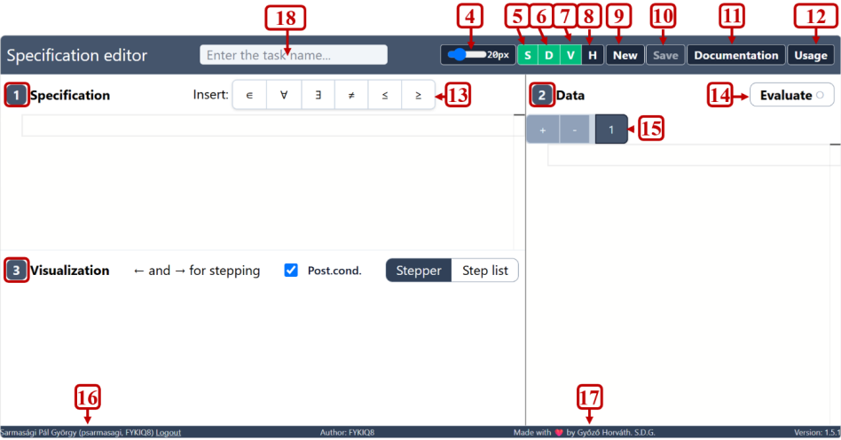
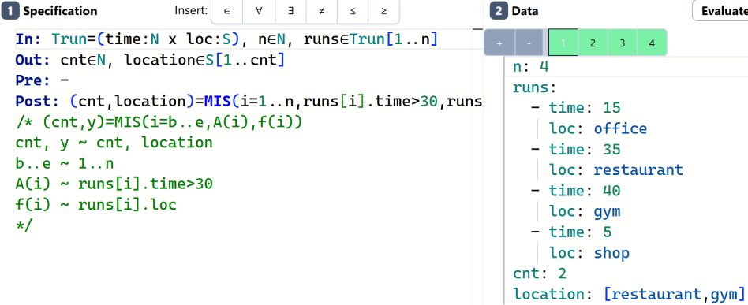

# A tour of the interface

The editor's window is divided into panes, with a toolbar across the top. The
numbers in the screenshot match the list below.

<figure>

<figcaption>The Specification Editor (version 1.5.1), with its parts numbered.</figcaption>
</figure>

| # | Element | What it does |
|--:|---------|--------------|
| 1 | **Specification pane** | Where you write the specification (top left). |
| 2 | **Data pane** | Where you write test cases (right). |
| 3 | **Visualization pane** | Shows the evaluation of the selected test case (bottom left). |
| 4 | Font size slider | Changes the font size of the editors. |
| 5 | <kbd>S</kbd> | Shows/hides the Specification pane. |
| 6 | <kbd>D</kbd> | Shows/hides the Data pane. |
| 7 | <kbd>V</kbd> | Shows/hides the Visualization pane. |
| 8 | <kbd>H</kbd> | Shows/hides the History pane (earlier saved versions). |
| 9 | **New** | Starts a new, empty specification. |
| 10 | **Save** | Saves the current specification on the server (see [Saving and sharing](ch01-03-save-share.md)). |
| 11 | **Documentation** | Opens the built-in documentation, in Hungarian (see [Appendix E](appendix-05-builtin.md)). |
| 12 | **Usage** | Opens the usage manual, in Hungarian. |
| 13 | **Insert** | Buttons that insert the special characters `∈ ∀ ∃ ≠ ≤ ≥`. |
| 14 | **Evaluate** | Evaluates the specification on every test case. |
| 15 | **Test case tabs** | One tab per test case. `+` adds one, `-` removes the selected one. After evaluation a tab turns green (passed) or red (failed). |
| 16 | Current user | Your name and login, with a *Logout* link. |
| 17 | Copyright | Author and version information. |
| 18 | **Task name** | The title of the specification. Give every specification a name before you save it. |

The green buttons <kbd>S</kbd>, <kbd>D</kbd>, <kbd>V</kbd> are toggles: green means
the pane is visible. If the screen is small, hide what you don't need. For
example, hide the Data pane while you work on the specification.

## The Specification pane

This is an ordinary text editor with syntax highlighting. Type the
specification here, block by block (`In:`, `Out:`, `Pre:`, `Post:`, …). The
**Insert** buttons above it (13) put the mathematical symbols at the cursor.
You can also type their ASCII equivalents:

| Symbol | Button | You can also type |
|:------:|:------:|-------------------|
| `∈` | ∈ | `element` (Hungarian: `eleme`) |
| `∀` | ∀ | `forall` (Hungarian: `minden`) |
| `∃` | ∃ | `exists` (Hungarian: `létezik`) |
| `≠` | ≠ | `!=` |
| `≤` | ≤ | `<=` |
| `≥` | ≥ | `>=` |

When the specification has an error, the editor marks the line and shows a
message such as `Line 3, column 7: Expected …`. Chapter
[Error messages and common mistakes](ch08-02-errors.md) explains the frequent
ones.

## The Data pane

Each tab of the Data pane holds one test case: values for the input variables
and the *expected* values of the output (and auxiliary) variables, in a
YAML-like format:

```yaml,fragment
n: 5
nums: [3, 72, 81, 4, 5]
cnt: 3
```

> [!TIP]
> Put the cursor in an empty test case and press <kbd>Shift</kbd>+<kbd>Space</kbd>,
> then <kbd>Tab</kbd>. The editor inserts a template with every declared variable,
> so you only have to fill in the values.

<figure>

<figcaption>Four test cases, all passing (green tabs). The data uses the
multi-line record format.</figcaption>
</figure>

## The Visualization pane

After you press **Evaluate**, this pane shows how the postcondition was
evaluated for the selected test case. It has two views:

- **Stepper**: one evaluation step at a time. Step with the <kbd>←</kbd> and
  <kbd>→</kbd> keys.
- **Step list**: all steps at once, one per line.

The **Post.cond.** checkbox decides whether the postcondition's evaluation is
shown. Chapter [Stepper and step list](ch08-01-stepper.md) explains how to
read the trace.
