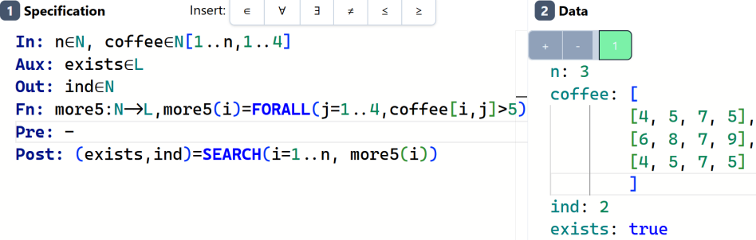

# Matrices and arrays of arrays

## Matrices

A **matrix** (two-dimensional array, *mátrix*) has two index ranges separated
by a comma:

```speci,fragment
m1∈Z[1..8,1..8]
```

This is an 8×8 matrix of integers. An element is addressed with **both indices
in one pair of brackets**: `m1[3,6]` is row 3, column 6.

| Declaration | Meaning |
|-------------|---------|
| `m1∈Z[1..8,1..8]` | 8×8 matrix |
| `m2∈Z[1..n,1..m]` | *n*×*m* matrix, with *n* and *m* as inputs |
| `m3∈Z[0..,0..]` | any size, indexed from 0; the data decides the size |
| `m4∈Z[,]` | shorthand for `Z[1..,1..]` |
| `m5∈Z[-1..1,-1..1]=[[2,1,2],[1,0,1],[2,1,1]]` | matrix with an initial value |

In the test data, a matrix is written as a list of rows:

```speci
In: n∈N, m∈N, t∈Z[1..n,1..m]
Out: s∈Z
Pre: -
Post: s=SUM(i=1..n, SUM(j=1..m, t[i,j]))
```

```yaml
n: 2
m: 3
t: [
  [1, 2, 3],
  [4, 5, 6]
]
s: 21
```

The same data on one line also works: `t: [[1,2,3],[4,5,6]]`.

<figure>

<figcaption>A 3×4 matrix in the Data pane. The guide lines show the
nesting.</figcaption>
</figure>

## Arrays of arrays

> [!WARNING]
> `m∈Z[1..n,1..m]` and `m∈Z[1..n][1..m]` are **not the same**.
> The first is a matrix, indexed as `m[i,j]`. The second is a
> *sequence of sequences*, indexed as `m[i][j]`. They can't be used
> interchangeably.

An array of arrays is useful when the rows have **different lengths**, a
"jagged" structure that a matrix can't describe. The cleanest way to write it
is with a named row type:

```speci
In: rows∈Row[], Row=N[]
Out: total∈N
Pre: -
Post: total=SUM(i=1..length(rows), length(rows[i]))
```

```yaml
rows: [[1, 2, 3], [4], [], [5, 6]]
total: 6
```

Here `rows[i]` is itself an array, so `length(rows[i])` is the length of row *i*
and `rows[i][j]` is one element.

## Quantifiers over matrices

Going through a matrix takes two nested loops. Quantifiers and theorems can be
nested the same way. This one says "every row contains a 10":

```speci
In: n∈N, m∈N, t∈N[1..n,1..m]
Out: ok∈L
Pre: -
Post: ok=FORALL(i=1..n, EXISTS(j=1..m, t[i,j]=10))
```

```yaml
n: 2
m: 3
t: [[10, 1, 2], [3, 10, 10]]
ok: true
```

```yaml
n: 2
m: 3
t: [[10, 1, 2], [3, 4, 5]]
ok: false
```

The worked example [Yossarian's map](ch09-02-yossarian.md) finds the maximum of
a matrix.
