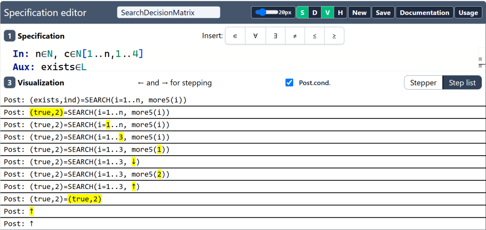

# Stepper and step list

The Visualization pane (toggle it with <kbd>V</kbd>) shows how the postcondition of the
**selected** test case was evaluated. It works like a debugger for the
specification. When a test is unexpectedly red, the pane shows *where* the
statement became false.

## The two views

| View | What it shows | Use it to… |
|------|---------------|------------|
| **Stepper** (default) | one step at a time; step with <kbd>←</kbd> and <kbd>→</kbd> | follow the evaluation slowly, value by value |
| **Step list** | every step at once, one per line | get an overview and spot where something changes |

The **Post.cond.** checkbox switches the display of the postcondition's
evaluation on or off.

## Reading the steps

Each step is the postcondition with one part replaced by its value. The part
that changed in the step is **highlighted in yellow**. Here is the step list of
a search ("find a day on which every coffee break was above 5"):

<figure>

<figcaption>The step list. The yellow highlight marks the part evaluated in
each step, and ↓/↑ mark entering and leaving a function.</figcaption>
</figure>

The steps, in order:

```text
Post: (exists,ind)=SEARCH(i=1..n, more5(i))     the original statement
Post: (true,2)=SEARCH(i=1..n, more5(i))         the outputs are substituted
Post: (true,2)=SEARCH(i=1..n, more5(i))         the lower bound: 1
Post: (true,2)=SEARCH(i=1..3, more5(i))         the upper bound: n = 3
Post: (true,2)=SEARCH(i=1..3, more5(1))         first iteration: i = 1
Post: (true,2)=SEARCH(i=1..3, ↓)                entering more5(1)…
Post: (true,2)=SEARCH(i=1..3, more5(2))         …false, next iteration: i = 2
Post: (true,2)=SEARCH(i=1..3, ↑)                more5(2) returned true
Post: (true,2)=(true,2)                         SEARCH gives (true, 2)
Post: ↑                                         the comparison is true
```

## Entering and leaving functions: ↓ and ↑

When the postcondition calls one of your `Fn:` functions, the trace marks it:

- **↓** the evaluation *enters* the function. The following steps are the
  function's body, with the parameter substituted.
- **↑** the function *returns* to the caller, and its value replaces the call.

The final `↑` lines mark the end of the evaluation of the whole postcondition.

## Typical debugging session

1. Select the red test case.
2. Open the **Step list** and find the first step whose value surprises you:
   a wrong bound, a function returning `false` where you expected `true`.
3. Switch to the **Stepper** and step through that part in detail.
4. Decide whether the **specification** or the **expected output** is wrong,
   and fix it.

> [!TIP]
> Make the failing test as small as possible first. A test with three
> elements produces a step list you can read in one glance.

## In speci-local

speci-local has a stepper too: choose *Stepper* in the Evaluation pane. It
shows the formula with the evaluated part highlighted, the value, and the
current loop variables. The ↓/↑ marks and the step list work the same way.
Its error messages also say *which* part of the postcondition is false and
what the specification computes, for example
"`cnt`: the test case says 2, the specification gives 3".
